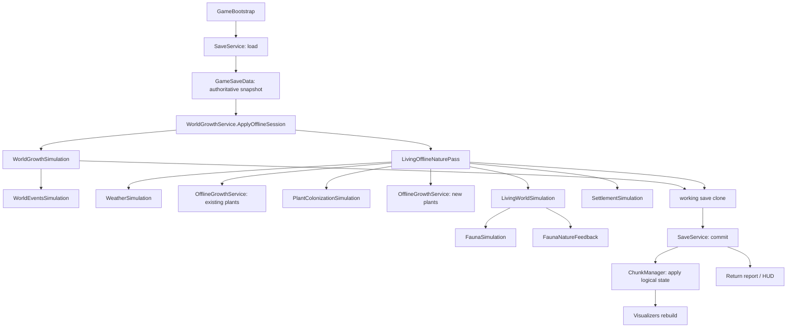

# AFK ISLAND — Architecture Map

**Версия карты:** 0.1  
**Дата аудита:** 2026-11-23  
**Ветка:** `main`  
**Срез проекта по `Docs/SPEC-EXECUTION.md`:** Unity 6 / URP, сборка 0.6.56, versionCode 86, Save v8.  
**Статус карты:** первичная карта по исходникам; зависимости и границы систем уточняются по мере углублённого аудита.

> Это карта фактических компонентов, найденных в `Assets/_Project/Scripts`, сопоставленная с действующими документами. Упоминание класса в карте не означает, что все его сценарии уже прошли независимую проверку.

## 1. Слои архитектуры

| Слой | Ответственность | Основные компоненты |
|---|---|---|
| Core / Composition | Сборка зависимостей, запуск игры и продолжение сессии | `GameBootstrap` |
| Save / Data | Авторитетное состояние, JSON, миграции, копирование данных | `GameSaveData`, `SaveService`, `SaveMigrationService`, `SaveClone`, `ChunkMaskCodec`, `BiomeMaskCodec` |
| Offline orchestration | Расчёт периода отсутствия, применение мира и фиксация результата | `WorldGrowthService`, `OfflineGrowthService`, `LivingOfflineNaturePass` |
| World simulation | Расширение суши, прогресс клеток, события мира | `WorldGrowthSimulation`, `WorldGrowthConfig`, `WorldEventsSimulation` |
| Living ecosystem | Погода, растения, колонизация, фауна и обратная связь | `WeatherSimulation`, `PlantColonizationSimulation`, `LivingWorldSimulation`, `FaunaSimulation`, `EcosystemSimulation` |
| Settlement | Рост маски поселения и производные жители | `SettlementSimulation`, `SettlementCellQuery`, `ResidentRoster`, `ResidentPathGraph`, `ResidentDirector`, `ResidentInstance` |
| Activities / Collection | Рыбалка и единая коллекция | `FishingController`, `FishingSimulation`, `FishingCatchProgress`, `FishCatalog`, `CollectionService` |
| World presentation | Чанки, меш земли, декор, вода, поселение, атмосфера | `ChunkManager`, `ChunkTerrainMesher`, `IslandMeshVisualizer`, `HomeSettlementVisualizer`, `WaterSourceLayout`, `WaterSurfaceApplicator`, `WorldAtmosphereVfx` |
| Player input / UI | Камера, жесты, экраны и отчёт возвращения | `IsometricCameraController`, `WorldPointerGesture`, UI presenters/HUD |
| Editor verification | Smoke-тесты и сборочные утилиты | `Assets/_Project/Scripts/Editor/*` |

## 2. Главный поток запуска и офлайн-прогресса

**Проверено по коду:** `GameBootstrap` связывает `SaveService`, `OfflineGrowthService`, `WorldGrowthService` и `ResidentDirector`. Основной офлайн-путь проходит через `WorldGrowthService.ApplyOfflineSession()`; `OfflineGrowthService` отдельно отвечает за рост/восстановление растений и оставлен как legacy fallback, если `WorldGrowthService` отсутствует.

**Порядок внутри живого офлайн-прохода:** погода → рост существующих растений → колонизация → рост новых растений за оставшееся время → симуляция живого мира/фауны → поселение. Поселение выполняется после обновления земли; watermark поселения защищает от повторного применения того же периода.

**Критическая граница:** симуляция работает с данными сохранения/рабочей копией; визуальные представления должны восстанавливаться из зафиксированного состояния. При неудачной записи watermark не должен считаться применённым.

## 3. Сохранение и модель данных

Основные файлы:

- `Save/GameSaveData.cs` — корневая модель сохранения и вложенные модели.
- `Save/SaveService.cs` — чтение/запись, authoritative snapshot, блокировка IO, временный файл и резервная копия.
- `Save/SaveMigrationService.cs` — создание дефолтов и миграции.
- `Save/SaveClone.cs` — глубокое копирование рабочего состояния.
- `Save/ChunkMaskCodec.cs` — упаковка клеточных масок.
- `Save/BiomeMaskCodec.cs` — маска биомов.

В `GameSaveData` присутствуют данные растений, чанков, расширения мира, экосистемы, погоды, животных, habitats, коллекции и рыбалки. Рост поселения хранится как маска в записи чанка расширения мира, а не как отдельный список GameObject-домов.

**Текущий контракт из документации:** Save v8. Не повышать версию и не менять миграции/формат ID без отдельного аудита и согласования.

## 4. Мир, чанки и расширение суши

| Компонент | Роль |
|---|---|
| `WorldGrowthConfig` | Параметры роста мира |
| `WorldGrowthSimulation` | Расчёт роста и событий на рабочей копии данных |
| `WorldGrowthService` | Оркестрация офлайн-сессии, объединение результатов, commit и обновление мира |
| `IslandChunk` | Представление чанка |
| `ChunkManager` | Логическое состояние чанков и загруженные чанки |
| `GrowthWorldPlacement` | Перевод координат мира/чанка/клетки |
| `ChunkTerrainMesher` | Геометрия поверхности из масок |
| `IslandMeshVisualizer` | Меши чанков и декор |
| `IslandPrototypeBuilder` | Авторская стартовая сцена/базовый остров |

**Координатный контракт из Stage 11G-A:** чанк 16×16 м, сетка 16×16, клетка 1×1 м; маска земли остаётся источником истины. Визуальная позиция объектов — отдельный слой, который планируется сделать менее привязанным к сетке.

## 5. Растения и колонизация

- `Plants/PlantCatalog.cs`, `PlantData.cs` — каталог и определения растений.
- `PlantInstance.cs`, `PlantPlot.cs`, `PlantingSystem.cs` — runtime-объекты и ручная посадка.
- `OnlineGrowthTicker.cs` — онлайн-обновление роста.
- `OfflineGrowthService.cs` — восстановление растений и офлайн-рост.
- `PlantColonizationSimulation.cs` — появление диких растений на доступных клетках.

**Контракт:** существующие координаты растений в сейве не переписывать без отдельного решения. `plotId` и `instanceId` используются как идентификаторы/ключи владения и дедупликации.

## 6. Экосистема, животные и погода

- `WeatherSimulation.cs` — расчёт погоды за период отсутствия.
- `DayNightWeatherVisual.cs`, `WorldVisualEnvironment.cs` — визуальное представление среды.
- `LivingWorldSimulation.cs` — общий проход живого мира после погоды.
- `FaunaSimulation.cs` — симуляция фауны.
- `FaunaNatureFeedback.cs` — обратная связь между результатами фауны и природой.
- `Animals/AnimalData.cs`, `AnimalInstance.cs`, `AnimalSpawner.cs`, `AnimalVisualMotion.cs` — данные и визуальные экземпляры животных.
- `EcosystemSimulation.cs` — отдельная экосистемная логика; её точные связи с основным офлайн-проходом требуют дополнительной проверки.

## 7. Поселение и жители

**Поселение как данные:**

- `SettlementSimulation.cs` обновляет клеточную маску поселения.
- Стадии маски: пусто, расчистка, тропа, камень, хижина.
- `SettlementCellQuery.cs` предоставляет запросы к маске и перевод мировой точки в клетку.
- `HomeSettlementVisualizer.cs` строит визуальные дома/тропы/камни из сохранённой маски.

**Жители как производный runtime-слой:**

- `ResidentRoster.cs` выводит жителей из клеток-хижин.
- `ResidentPathGraph.cs` ищет маршруты по клеткам троп/камней.
- `ResidentDirector.cs` создаёт и управляет runtime-экземплярами.
- `ResidentInstance.cs` представляет отдельного жителя.

Согласно `SPEC-EXECUTION.md`, Stage 13 закрыт на 0.6.56 / versionCode 86. Жители не записываются в Save v8; их список строится из маски хижин. Не переоткрывать Stage 13 без отдельного решения.

## 8. Вода и визуальная среда

- `WaterSourceLayout.cs` — авторская раскладка источника воды/пруда.
- `WaterSurfaceApplicator.cs` — визуальное применение поверхности воды.
- `WorldAtmosphereVfx.cs` — атмосферные визуальные эффекты.
- `VegetationWindApplicator.cs` — применение визуального ветра к растительности.
- `ChunkTerrainMesher.cs` и `IslandMeshVisualizer.cs` — земля и растительный/каменный декор.

**Ограничения действующих контрактов:** не менять пороги LOD и формулу sway без отдельного провала соответствующего smoke/device-чеклиста; не создавать вторую систему воды.

## 9. Рыбалка и коллекция

**Рыбалка:**

- `FishCatalog.cs` / `FishData.cs` — каталог видов.
- `FishingController.cs` — runtime FSM и попытка ловли.
- `FishingSimulation.cs` — выбор/расчёт результата.
- `FishingOceanInput.cs` / `FishingPondInput.cs` — вход из океана и пруда.
- `FishingCatchProgress.cs` — регистрация успешного улова.
- `FishingUI.cs` — интерфейс.

Документация фиксирует FSM: `Closed → Ready → Wait → Bite → Result`. Успешный улов регистрируется один раз; Miss/Cancel/EmptyPool не должны открывать запись в коллекцию.

**Коллекция:**

- `CollectionService.cs` — единый канонический сервис открытий.
- `CollectionUI.cs` — отображение коллекции.

Не создавать параллельные счётчики открытий в отдельных UI.

## 10. Управление и интерфейс

- `Camera/IsometricCameraController.cs` — изометрическая камера.
- `Input/WorldPointerGesture.cs` — жесты/указатель мира.
- `Input/AndroidMouseScroll.cs` — прокрутка/мышиный ввод для Android/эмулятора.
- `UI/MainMenuHud.cs`, `EcosystemHud.cs`, `ReturnReportHud.cs`, `ReturnSummaryHud.cs`, `ReturnReportEventsPresenter.cs`, `IslandExpansionFeedback.cs`, `CollectionUI.cs` — экраны, HUD и отчёт возвращения.

Точные зависимости UI от сервисов и правила блокировки игрового ввода будут уточнены в отдельном проходе по UI-коду.

## 11. Проверки и smoke

В `Assets/_Project/Scripts/Editor` обнаружены отдельные smoke-проверки для:

- сохранения/масок и офлайн-прохода;
- поселения и жителей;
- рыбалки, пруда и коллекции;
- растительности, ветра и визуальной среды;
- жестов/камеры и сборки Android.

Ключевые файлы: `LivingOfflineSmoke.cs`, `SettlementAuditSmoke.cs`, `ResidentSmoke.cs`, `CollectionServiceSmoke.cs`, `FishingControllerSmoke.cs`, `FishingSimulationSmoke.cs`, `FishingPondInputSmoke.cs`, `VegetationWindMaterialsSmoke.cs`, `WorldAtmosphereRootSmoke.cs`.

Наличие smoke-файла не равно подтверждённому прохождению теста на текущем HEAD. Результаты запуска и device-pass фиксируются отдельно.

## 12. Текущий статус проекта и открытый фронт

Согласно `Docs/SPEC-EXECUTION.md`:

- Сборка: 0.6.56 / versionCode 86.
- Сохранение: v8.
- Stage 12 — аудит поселения и device-pass закрыты на 0.6.50.
- Stage 13 — Resident AI закрыт на 0.6.56.
- Stage 11G-A — аудит и контракт органической генерации мира; код не менялся.
- Реализация 11G начинается только после утверждения контракта.
- Темп симуляции не менять; `TZ-FAST-PROGRESSION.md` сейчас не выполняется.
- Пороги LOD и формулу sway не трогать.

Открытые вопросы по 11G перечислены в `Docs/TZ-11G-Organic-World.md`: форма стартовой площадки, судьба уже сохранённых 120 растений, процедурные массивы/авторские якоря и верхняя граница плотности.

## 13. Что ещё нужно проверить для карты 1.0

1. Полный call graph `GameBootstrap` → `WorldGrowthService` → Save commit → восстановление визуала.
2. Поля `GameSaveData` и соответствие каждого поля конкретной системе-владельцу.
3. Все зависимости `ChunkManager` от Save и visualizers, включая жизненный цикл загруженных чанков.
4. Точные связи `EcosystemSimulation`, `WorldEventsSimulation`, `WeatherSimulation` и отчёта возвращения.
5. Контракт ручной посадки относительно масок земли, воды, поселения и офлайн-колонизации.
6. Полный поток рыбалки: Ocean/Pond input → Controller → Simulation → CatchProgress → Collection.
7. UI/input ownership: какие окна блокируют камеру, world taps и мини-игры.
8. Проверки производительности и ограничения по количеству чанков/GameObject.

---

## Источники

- `Docs/AFK-ISLAND-MASTER-SPEC.md`
- `Docs/SPEC-EXECUTION.md`
- `Docs/TZ-11E-2-Vegetation.md`
- `Docs/TZ-11G-Organic-World.md`
- `Docs/TZ-12-Settlement-Audit.md`
- `Docs/TZ-13-Resident-AI.md`
- Исходники `Assets/_Project/Scripts/**` перечисленных выше систем.
