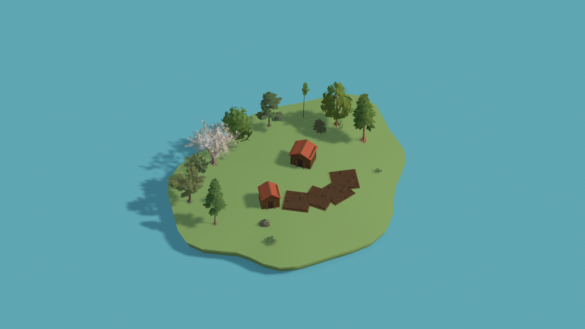
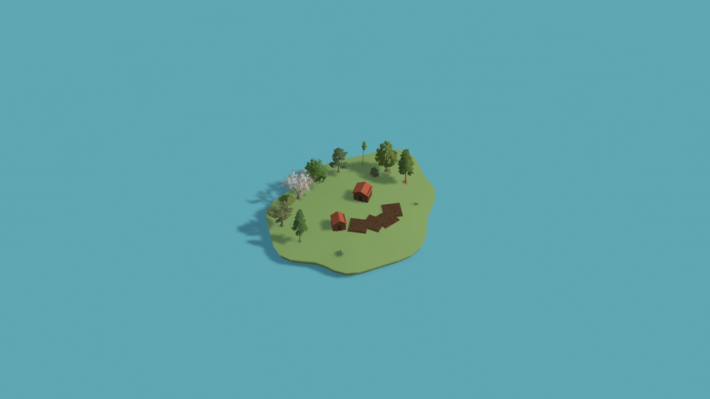
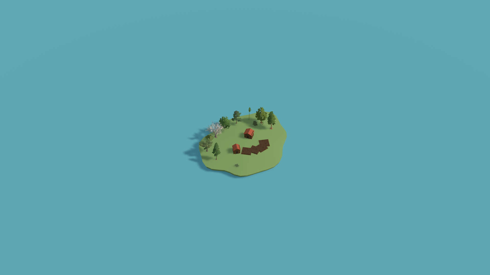

# Stage B-2 — отчёт о проверке в Unity Editor

Дата: 26.11.2026
Ветка: `feature/cozy-diorama-stage-b2`
Базовый коммит перед отчётом: `bc77e3d`
Unity: 6000.6.5f1 (Editor 6.6), URP, Windows

Этап B-2 — композиционная проверка масштаба деревьев на изолированной сцене. Выбран вариант V2 (1.75H / 2.25H / 3.00H к высоте хижины H = 0.96 м). Этап C и D не начинались.

## 1. Что изучено
- `Docs/CozyDiorama/STAGE-B2-UNITY-VERIFICATION.md` — процедура проверки и список пунктов отчёта.
- `Docs/CozyDiorama/STAGE-B1-DECISION-AND-STAGE-B2-HANDOFF.md` — решение по V2.
- `Assets/_Project/Scripts/Editor/CozyDioramaStageB2Builder.cs` — генератор сцены.
- `Builds/cozy-diorama/stage-b-scale-measure.txt` — измерения высот деревьев и хижины.

## 2. Что изменено
- `CozyDioramaStageB2Builder.cs` — добавлен пункт меню `AFK Island → Cozy Diorama → Stage B-2 → Render Review Shots`. Открывает сохранённую сцену, рендерит `StageB2_Camera` при трёх размерах orthographic (7.5 / 12.8 / 17), возвращает исходный размер и не сохраняет сцену.
- Добавлены в git: сгенерированная сцена `Assets/_Project/Scenes/Prototypes/CozyDioramaStageB2.unity`, mesh острова `Assets/_Project/Art/CozyDiorama/CozyDioramaStageB2_IslandMesh.asset` (с `.meta`), эти PNG и этот отчёт.
- Не затронуты: `MainIsland`, игровые префабы, Save v8, миграции, симуляция, WorldGrowthConfig, логика растений/животных/рыбалки/коллекции/Resident AI, постоянные ID, логические координаты.
- Незакоммиченные правки 11G (9 файлов `.mat`, `.cs`, `ProjectSettings.asset`) в коммиты не входят и не менялись.

## 3. Что проверено в Unity
- Компиляция после правки билдера: `error CS` в `Editor.log` нет. Предупреждения прежние: `CS0162` в `ResidentSmoke.cs(509)` и `Rock_A` convex hull.
- Сцена `CozyDioramaStageB2` открыта из сохранённого файла, пометка изменений снята, сцена не сохранялась поверх файла.
- Рендер трёх планов через `StageB2_Camera`, 1920×1080, с warm-up кадрами. Чёрной земли и фиолетовой листвы нет.
- Отсутствующих prefab нет.
- Play Mode и Android build не запускались.

## 4. Визуальная оценка

### Крупный план (ortho 7.5)

- Хижины различимы, крыши не перекрыты деревьями.
- Центр поселения открыт, между хижинами ничего не стоит.
- Задняя роща образует дугу по краю острова и не закрывает поселение.
- Корни деревьев видны у основания, объекты стоят на траве; парящих или утопленных объектов не замечено.
- Дорожка (`Path_Tile`) читается как набор отдельных тёмных плит с видимой толщиной и смещениями, а не как единая тропа. Требует отдельной визуальной правки.
- Узкая высокая ель в верхней части кадра выглядит почти голым стволом с небольшой кроной (уже известная проблема пропорций узких елей).

### Средний план (ortho 12.8, дефолт)

- Остров, поселение и береговая линия читаются целиком.
- Тени деревьев падают на воду слева, выглядит естественно.
- Дорожка по-прежнему читается как плиты.

### Общий план (ortho 17)

- Форма острова читается, вода — плоский placeholder.
- Хижины различимы, деревья выше хижин, как и задумано для V2.

## 5. Проверки в Editor, которые не выполнены
- Контакт корней с поверхностью на большом увеличении (проверено визуально, не замерено).
- Детальная проверка дорожки (стыки, высота над травой).
- Hut-resident mismatch: капсула жителя 0.90 м против хижины 0.96 м, дверь 0.45 м. Это логика/визуал жителей, в B-2 не меняется.

## 6. Риски
- Дорожка может выглядеть как «доски» в финальном стиле. Нужна отдельная правка перед C.
- Узкие ели при V2 выглядят тонкими на среднем плане.
- Вода — только placeholder, финальный стиль воды не проверялся.

## 7. Что нужно решить
- Утвердить V2 как основной масштаб для этапа C или выбрать другой вариант.
- Решить, нужна ли правка дорожки до этапа C.
- Решить судьбу случайных файлов `Builds/save-forest-fixture.json` и `Builds/save-forest-fixture-report.txt` (созданы ошибочным запуском `Build Forest Fixture (11G-B)`; gitignored, в git не попадают).

## 8. Файлы
- Сцена: `Assets/_Project/Scenes/Prototypes/CozyDioramaStageB2.unity`
- Mesh острова: `Assets/_Project/Art/CozyDiorama/CozyDioramaStageB2_IslandMesh.asset`
- Скриншоты: `Docs/CozyDiorama/StageB2-Shots/close_7_5.png`, `medium_12_8.png`, `overview_17.png`
- Исходные рендеры в `Builds/cozy-diorama/stage-b2-shots/` (gitignored)
