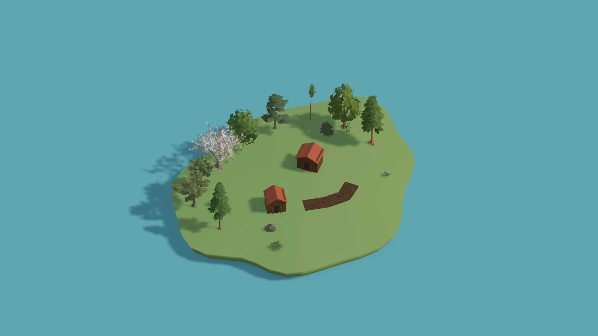
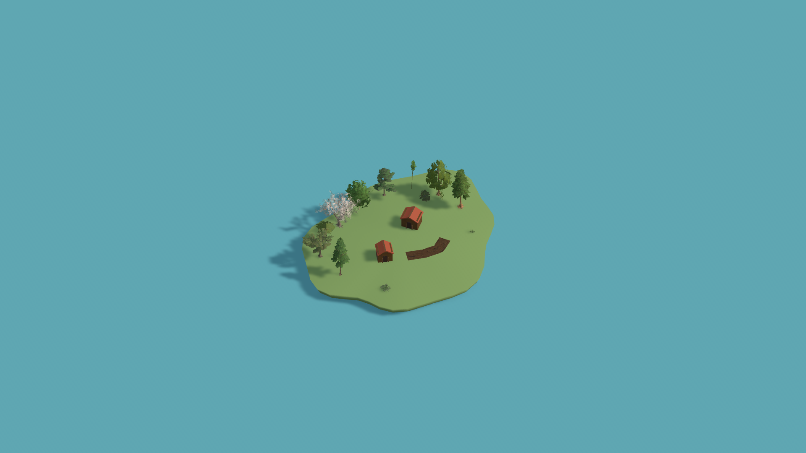
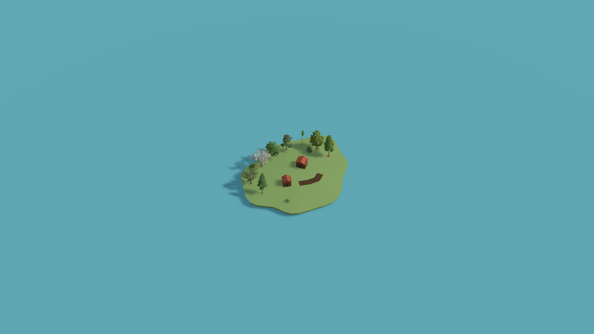

# Stage C — path refinement: отчёт о проверке в Unity Editor

Дата: 26.11.2026
Ветка: `feature/cozy-diorama-stage-c-path-refinement`
Базовый коммит: `f2dfde0`
Unity: 6000.6.5f1, URP, Windows

Область: только изолированная сцена `CozyDioramaStageB2`. Производственный код, `Path_Tile.prefab`, `MainIsland`, Save v8, симуляция, плотность леса и скорость роста не менялись.

## Что проверено
- Компиляция после переключения на ветку: `error CS` в `Editor.log` нет (предупреждение `CS0162` в `ResidentSmoke.cs` прежнее).
- `AFK Island → Cozy Diorama → Stage B-2 → Build Composition Review Scene` отработал, сцена сохранена, создан `Assets/_Project/Art/CozyDiorama/CozyDioramaStageC_PathRibbon.asset`.
- `Render Review Shots` отработал: три PNG 1920×1080 (7.5 / 12.8 / 17).
- Play Mode и Android build не запускались.

## Скриншоты

Крупный план (ortho 7.5):

Средний план (ortho 12.8):

Общий план (ortho 17):

Кадры B-2 «до» (с четырьмя плитами) остаются в `StageB2-Shots/`.

## Результат по критериям из `STAGE-C-PATH-REFINEMENT.md`
- Дорожка читается как одна непрерывная лента, без отдельных плит и видимой толщины: исправлено.
- Лента лежит на траве, не парит и не торчит над поверхностью.
- Хижины читаемы, роща V2 не изменилась.
- Ленту видно на всех трёх планах, на среднем и общем она тонкая, но различима.

## Замечания
- Лента короткая и не соединяет хижины: она начинается и заканчивается на траве, ни одна дверь не имеет подхода к дорожке. Выглядит как отдельная полоса сбоку от поселения.
- Материал взят из `Path_Tile` (тёмно-коричневый), цвет резко контрастирует с травой, детали текстуры на ленте почти не видны.
- Края ленты прямые, без мягкого перехода в траву.
- Узкие ели по-прежнему выглядят тонкими (отдельное замечание B-2, не менялось).

## Что осталось
- Решить, соединять ли дорожку с дверями хижин и добавить ли ответвления.
- Решить, нужен ли более светлый тон и мягкий край ленты.
- Узкие ели не трогались.
- Файлы `Builds/save-forest-fixture*` остаются в `Builds/` (gitignored, случайный запуск Forest Fixture ранее).
