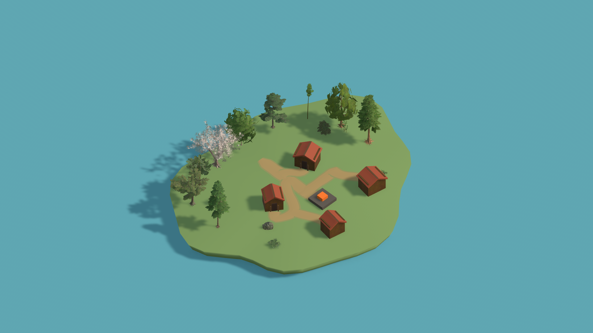
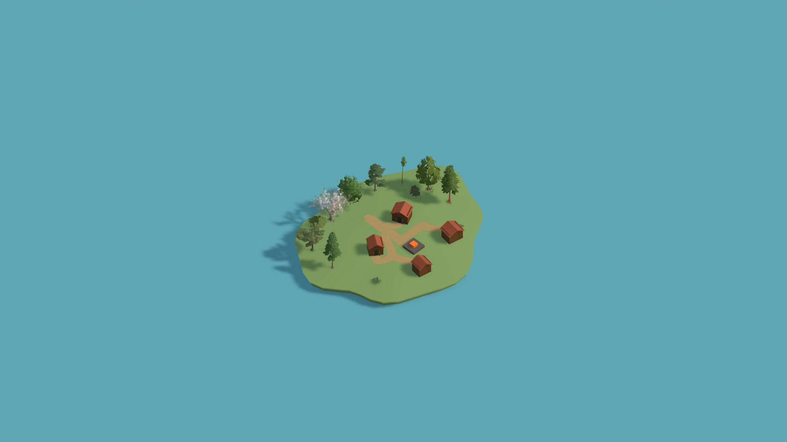
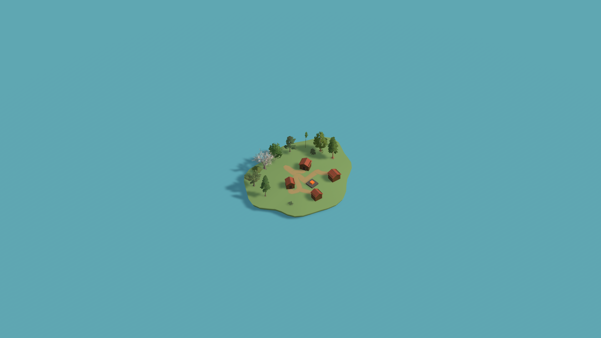
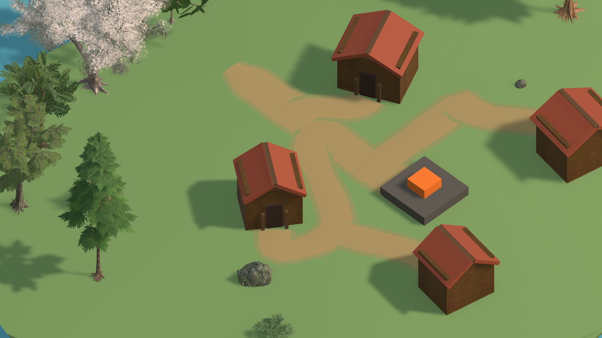
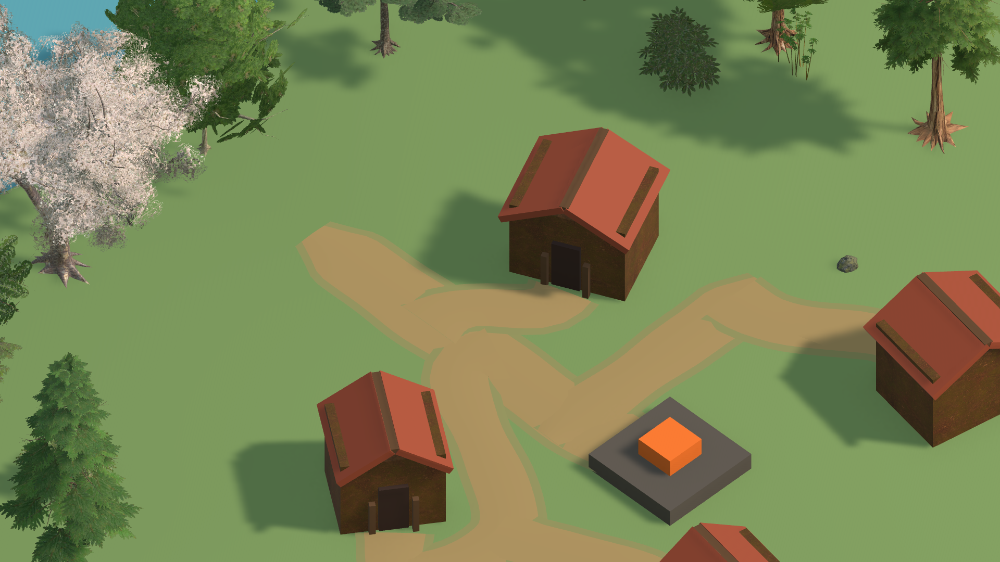
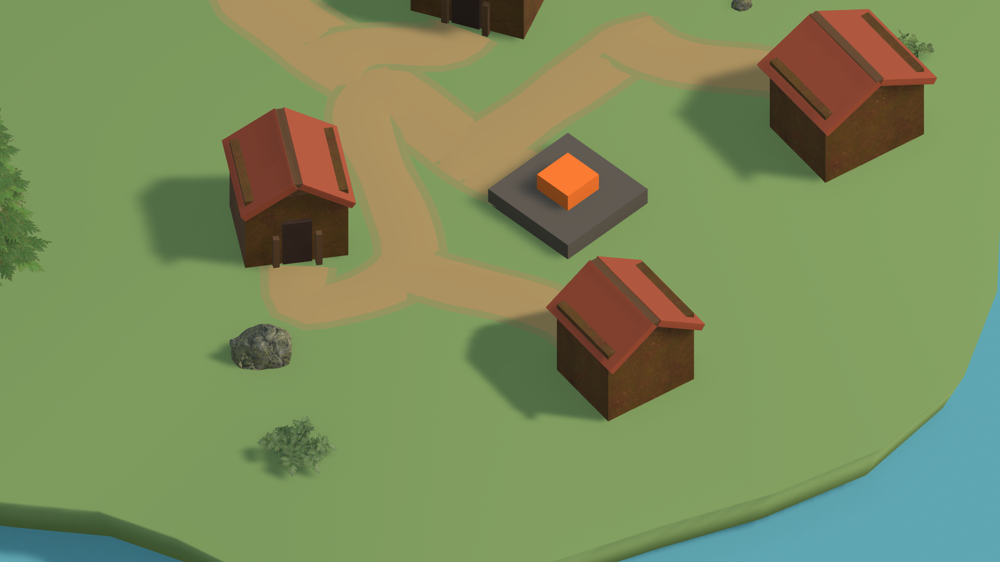
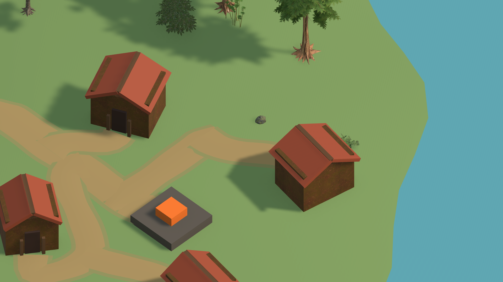
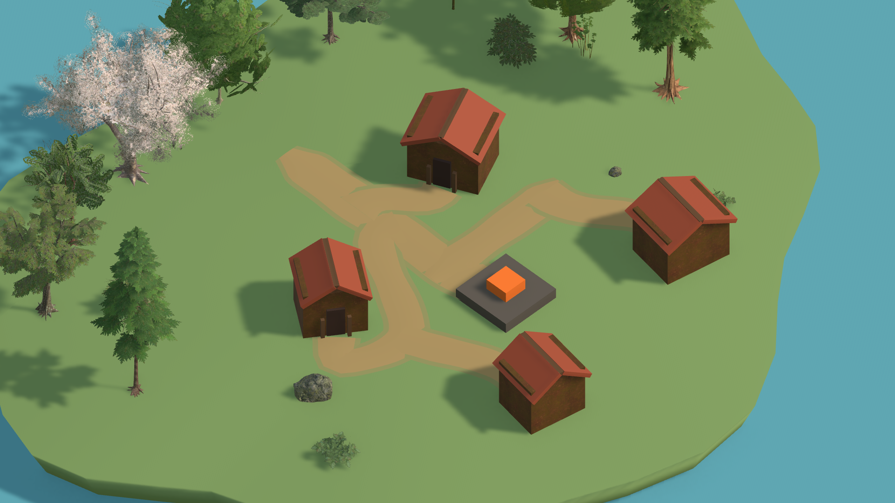

# Stage C-2B — Verification report (path network prototype)

**Branch:** `feature/cozy-diorama-stage-c2-settlement-path-network`  
**Scene:** `Assets/_Project/Scenes/Prototypes/CozyDioramaStageC2.unity` (a copy of B-2; B-2 untouched)  
**Raw report:** [`StageC2-Shots/network-report.txt`](StageC2-Shots/network-report.txt)

## What was built

Variant 1: the B-2 layout stays (two huts, grove, rocks). Added a hearth and a starter network at the `IslandPrototypeBuilder` coordinates, plus two test huts as extension points:

| Object | Position | Yaw | Role |
|---|---|---|---|
| Hut_A | (-1.65, -0.15) | 215 | existing B-2 hut |
| Hut_B | (1.35, 0.65) | 245 | existing B-2 hut |
| Hut_Test_03 | (-0.90, -3.20) | 10 | test hut, joins a hut branch |
| Hut_Test_04 | (2.30, -2.50) | 10 | test hut, joins the cross path |
| Hearth | (0.15, -1.50) | — | start of `Starter_Main` |

## Checks (from the generated report)

| Check | Result |
|---|---|
| B-2 scene hash before / after | `7410EE060BA4E329` / `7410EE060BA4E329` — unchanged; B-2 absent from `git status` |
| Deterministic rebuild | plan hash `31B7DFFB00530056` and mesh hash `EC21663F331512D7` identical |
| Door approach (first segment · door forward) | A 0.98, B 0.88, Test_03 1.00, Test_04 0.98 |
| Violations (hut footprint / rocks / island outline) | none for all four huts |
| Min clearance to any hut footprint | 0.32–0.48 m |
| Junction: branch end vs trunk | 0.08 m from trunk centreline, trunk half-width ≥ 0.25 m — overlapping in all four |

Routes:

| Hut | Joins | Variant | Length |
|---|---|---|---|
| Hut_A | Starter_Main (0, 0.34) | wrap-right | 3.66 m |
| Hut_B | Starter_Main (0, 0.94) | bezier-soft | 1.20 m |
| Hut_Test_03 | Branch_Hut_A (-1.31, -1.13) | bezier-soft | 1.83 m |
| Hut_Test_04 | Starter_Cross (1.80, -0.60) | bezier-soft | 1.68 m |

## Screenshots

Overview, medium and close shots (ortho, 45°/45°):

Details (doors, junctions, branching):

Note: the doors of `Hut_Test_03` / `Hut_Test_04` face away from the review camera, so their door approach is confirmed by the numbers above, not visually.

## Findings

1. Four huts connect to the network without violations; branching from a hut branch (Test_03 → Branch_Hut_A) and from the cross path (Test_04) both work.
2. A door facing away from the network has no clean route (best candidate: a 5.26 m loop). Production hut placement must orient doors toward the network/hearth. `Hut_A` shows a milder case (3.66 m wrap).
3. The hearth is the start of `Starter_Main`; its connection is visible in the shots.
4. Inherited bug fixed in the rewrite: the earlier ribbon winding produced downward normals.
5. Tooling caveats: the GPU Resident Drawer shows stale renderers in the same editor frame — shots are rendered after a scene reload on later editor ticks; after editing the builder, wait for recompile before running the menu.

## Not run / not verified

- Play Mode, Android build and device checks were **not** run.
- No production code was changed or integrated; no terrain, water or chunk-boundary routing.
- Visuals were checked only in the isolated review scene.

## Untouched

The 9 uncommitted "11G" files and `Builds/save-forest-fixture*` were not modified or committed. Save v8, growth, offline simulation, island expansion, plant/animal logic, IDs, fishing, collection, Resident AI, `ResidentPathGraph` and `ResidentRoster` are unchanged.
