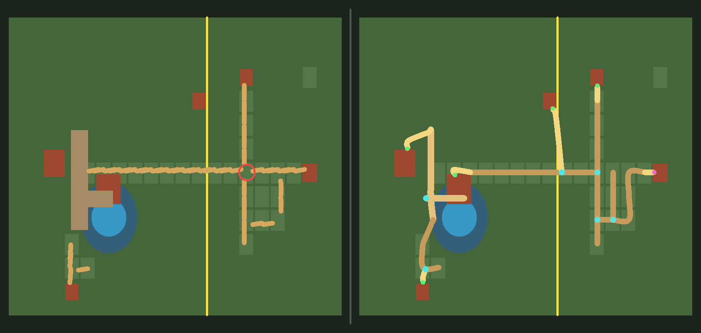
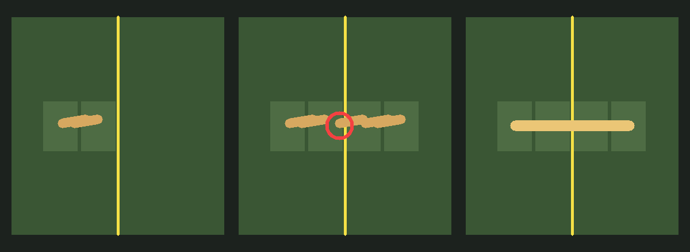

# Stage C-3B — сравнение 11G и C-2B, аудит воды, воспроизведение границы чанков, бенчмарки и чистый планировщик топологии

**Ветка:** `feature/cozy-diorama-stage-c2-settlement-path-network`  
**План:** [`STAGE-C3-PRODUCTION-PATH-NETWORK-INTEGRATION-PLAN.md`](STAGE-C3-PRODUCTION-PATH-NETWORK-INTEGRATION-PLAN.md)  
**Аудит C-3A:** [`STAGE-C3A-PRODUCTION-AUDIT.md`](STAGE-C3A-PRODUCTION-AUDIT.md)  
**Сырой отчёт прогона в Unity:** [`StageC3B-Report/c3b-test-and-benchmark-report.txt`](StageC3B-Report/c3b-test-and-benchmark-report.txt)

## 1. Что создано (изолированно, без правок production)

- `Assets/_Project/Scripts/World/SettlementPathTopology.cs` — чистый детерминированный планировщик визуальной топологии сети дорожек. Без зависимостей от `MonoBehaviour`, `GameSaveData`, симуляции и навигации жителей (`ResidentPathGraph` / `ResidentRoster` не затронуты).
- `Assets/_Project/Scripts/Editor/CozyDioramaStageC3BHarness.cs` — редакторный стенд (`AFK Island → Cozy Diorama → Stage C-3 → Run C-3B Offline Topology & Comparison Suite`), выполняющий все 6 шагов C-3B и 10 офлайн-тестов.
- `Docs/CozyDiorama/StageC3B-Report/` — сырой текстовый отчёт и две схемы сравнения PNG, построенные из реальных данных прогона.

Production-файлы, сцены, префабы, Save v8, 9 незакоммиченных файлов «11G» и `Builds/save-forest-fixture*` не изменялись.

## 2. Шаги 1 и 2 — сравнение 11G `PlacePathRibbon` и чистого планировщика на общей маске

Общие входные данные: 2 чанка `(0,0)` и `(1,0)`, 28 дорожных клеток (`Path`/`Stone`), 6 хижин (2 production-стартовые по `IslandPrototypeBuilder.CreateStarterSettlement` + 4 выросшие), 4-сторонний перекрёсток `(18,8)`, Т-перекрёсток `(18,7)`, плотный блок 2×2 `(19..20, 6..7)`, ветка рядом с прудом `(7,5)–(8,4)` и изолированная клетка `(22,12)`.

*Легенда схемы:* жёлтая вертикаль — граница чанков `x = 8.0 м`; синий эллипс — чистая вода пруда (`rx=1.1, rz=0.8`), тёмно-синее кольцо — `BlocksSettlement` (`rx=1.8, rz=1.5`); красные квадраты — хижины; голубые точки справа — явные узлы перекрёстков (`PathJunction`); зелёные/пурпурные точки — двери (как есть / с визуальной коррекцией).

| Критерий | 11G `PlacePathRibbon` (зеркало правил) | `SettlementPathTopology` (чистый планировщик) |
|---|---|---|
| Примитивы геометрии | 44 отдельных рукава по краям клеток | 22 узла, 20 непрерывных полилиний, 6 явных перекрёстков |
| 4-сторонний перекрёсток `(18,8)` | **Баг: 0 рукавов (дыра в центре)** — при `throughX && throughZ` не срабатывает ни одна ветка `if/else if` | Явный узел перекрёстка (degree = 4), все 4 ветви сходятся без разрыва |
| Т-перекрёсток `(18,7)` | **Баг: 2 рукава вместо 3** — боковая дорога в `(19,7)` отброшена (рисуется только если сосед — `Hut`), блок 2×2 визуально оторван | Явный Т-перекрёсток, боковой блок соединён с магистралью |
| Ветка у пруда `(7,5)–(8,4)` | Оторвана от стартового пути, разрыв в стыке с `(8,4)` | Непрерывно стыкуется со `Starter_Main`, обходя пруд |
| Подход к дверям хижин | Нет — рукава обрываются у границы клетки / круглого двора, дочерний `Door` игнорируется | Все 6 хижин подключены к реальному `Door` (dot 0.98–1.00, 0 нарушений); `Hut_Grown_East_Reversed` подключена за 0.54 м через визуальную коррекцию поворота (`90° → -90°`) без изменения симуляции |
| Связь со стартовым поселением | Нет — стартовые кубы живут отдельно и приглушаются через `SoftDimAuthored` | Единый граф со стартовыми путями и очагом |
| Граница чанков при инкрементальном обновлении | **Баг подтверждён** (см. шаг 4) | Единое ребро в мировых координатах (`TouchedChunks = 2`) + инвалидация соседних чанков |

## 3. Шаг 3 — аудит воды (`WaterSourceLayout`)

Параметры из кода: центр пруда `(1.80, -1.40)`, чистая поверхность воды `rx = 1.10, rz = 0.80`, резерв `BlocksSettlement` (`SettlementFootprintRadius = 0.70`) → `rx = 1.80, rz = 1.50`.

Находки на production-раскладке `IslandPrototypeBuilder.CreateStarterSettlement`:
- `Starter_Main`: чистую воду не задевает, но южный конец `(0.15, -1.50)` и `Hearth` попадают в резерв `BlocksSettlement`.
- `Starter_Cross` (`z = -0.60`, `x ∈ [-0.30, 2.10]`): **задевает край чистой воды с учётом полуширины ленты** (первая точка касания `(0.96, -0.60)` / `(1.02, -0.60)`) и целиком входит в резерв `BlocksSettlement` начиная с `x = 0.30`.
- `Starter_Hut_B` `(1.80, -0.20)`: вне чистой воды, но внутри резерва `BlocksSettlement`.
- `Starter_Hut_A` `(-1.60, 0.90)`: вне чистой воды и вне резерва.
- Сгенерированные дорожки: 0 входов в чистый эллипс пруда и в 11G, и в `SettlementPathTopology` (жёсткое ограничение `water_crossing` подтверждено тестом `T6` и `T10`).

**Вывод для C-3C:** для генерируемых дорог использовать жёсткую проверку по чистому эллипсу пруда + полуширина ленты + отступ берега, а для стартового `Starter_Cross` в C-3C предусмотреть аккуратное прижатие севернее берега пруда (или явный зазор), чтобы бахрома дорожки не залезала в воду.

## 4. Шаг 4 — воспроизведение бага границы двух чанков

- **T0:** чанк `(0,0)` имеет `Path` в `(14,8)` и на границе `(15,8)`; чанк `(1,0)` пуст. В `(15,8)` строится 0 восточных рукавов.
- **T1:** в чанке `(1,0)` вырастают `Path` в `(16,8)` и `(17,8)`. Маска чанка `(0,0)` не изменилась.
- **Результат в 11G:** `chunkSig` чанка `(0,0)` в T1 полностью совпадает с T0 (`True`). `HomeSettlementVisualizer` пропускает перестройку `(0,0)`. В результате `(16,8)` рисует западный рукав к границе, а `(15,8)` **не рисует** восточный рукав (красный круг в центре схемы — асимметричный разрыв до следующего изменения `(0,0)` или перезагрузки сцены). **Баг подтверждён.**
- **Результат в `SettlementPathTopology`:** мировое ребро проходит через `x = 8.0 м` непрерывно (`TouchedChunks = 2`), а `GetAffectedChunksForCellChange(16, 8)` возвращает оба чанка `(0,0)` и `(1,0)`.

## 5. Шаг 5 — стоимость сигнатур, поиска клеток и планировщика

Измерено в Unity Editor (`Stopwatch`, прогрев выполнен; редакторные цифры — ориентир, мобильный бюджет требует профилирования на Android в C-3E).

### 5.1 `BuildSignature` (вызывается каждый кадр в `HomeSettlementVisualizer.LateUpdate`)
| Мир | Время / вызов | При 60 fps | Оценка аллокаций / вызов |
|---|---:|---:|---:|
| 4 чанка (2×2) | 12.0 мкс | 0.72 мс/с | ~4.2 КБ |
| 9 чанков (3×3) | 19.0 мкс | 1.14 мс/с | ~12.4 КБ |
| 25 чанков (5×5) | 84.9 мкс | 5.09 мс/с | ~6.2 КБ |
| 49 чанков (7×7) | 176.2 мкс | 10.57 мс/с | ~11.0 КБ |

**Вывод:** на 25–49 чанках ежекадровая сборка и сортировка строк в `LateUpdate` создаёт заметную GC-нагрузку (~370–660 КБ/с). Для production нужен счётчик ревизии / событие изменения маски вместо строковой сигнатуры каждый кадр.

### 5.2 `SettlementSimulation.SampleSettlementStage` против кэша декодированных масок
Причина торможения, выявленная в коде: `SampleSettlementStage` делает линейный поиск чанка **и заново декодирует Base64 на каждый вызов**. Для 1 перестройки чанка (256 клеток × 6 чтений соседей = 1536 вызовов):

| Мир | Production `SampleSettlementStage` | Кэш `Dictionary<long, byte[]>` | Ускорение | Совпадение результата |
|---|---:|---:|---:|:---:|
| 4 чанка | 3.410 мс | 1.504 мс | 2.3× | `True` |
| 9 чанков | 3.551 мс | 0.081 мс | **43.7×** | `True` |
| 25 чанков | 4.199 мс | 0.129 мс | **32.7×** | `True` |
| 49 чанков | 4.136 мс | 0.190 мс | **21.8×** | `True` |

### 5.3 `SettlementPathTopology.Build`
- Общая 2-чанковая сцена (26 дорожных клеток, 6 хижин): **32.93 мс** (единоразово при изменении поселения, не каждый кадр).
- Худший случай 25 чанков (600 дорожных клеток, 16 хижин → 117 узлов, 112 рёбер, 41 перекрёсток): **83.31 мс** при полной пересборке всего мира.
- **Вывод для C-3C/C-3D:** планировщик никогда не должен вызываться каждый кадр; нужен запуск только по изменению поселения/земли, плюс в C-3C/C-3D стоит пересчитывать маршруты только для затронутых чанков/хижин (инкрементальный бюджет < 5 мс на событие роста).

## 6. Шаг 6 — результаты 10 офлайн-тестов чистого планировщика

Прогон в Unity 6000.6.5f1: компиляция без новых ошибок, **10/10 PASS**.

| Тест | Статус | Что подтверждено |
|---|:---:|---|
| `T1_StarterOnly_ProductionPoses` | PASS | Стартовые `Hut_A` и `Hut_B` по production-координатам подключены (`dot=0.99`), 1 компонента, 2 перекрёстка |
| `T2_FourHutFixture_C2BLayout` | PASS | 4/4 хижины C-2B подключены без визуальной коррекции, 1 компонента |
| `T3_BranchToBranchJoin` | PASS | `Hut_02` примыкает к ветке `Branch_Hut_01` с созданием явного Т-перекрёстка (не на пороге двери `Hut_01`) |
| `T4_MultipleSimultaneousHuts_OrderIndependent` | PASS | 6 хижин одновременно, обратный порядок входа даёт идентичный `TopologyHash` (`246C184ABB91D83A`) |
| `T5_ReversedDoor_HardRejectAndVisualCorrection` | PASS | Без визуальной коррекции — жёсткий отказ (без форсированной петли через хижину/берег); с визуальной коррекцией — чистый подход (`90° → 270°`, 1.97 м) без смещения хижины |
| `T6_BlockedJoin_WaterBarrierNeverCrossed` | PASS | Хижина за рекой остаётся `UnconnectedBlocked` с нарушением `water_crossing`, невалидное ребро не создаётся |
| `T7_DuplicateInput_Deduplicated` | PASS | Дубли хижин и клеток отфильтрованы, хэш совпадает с чистым входом |
| `T8_DeterministicRebuild_PermutationInvariant` | PASS | Повторная сборка с перевёрнутыми списками входа даёт идентичный хэш (`26410A15578634C8`) |
| `T9_TwoChunkBorderRepro_AndInvalidation` | PASS | Баг `chunkSig` в 11G воспроизведён; топология строит непрерывное ребро через границу и инвалидирует смежные чанки (4 для угловой клетки) |
| `T10_NoGeneratedEdgeCrossesWater` | PASS | 0 сэмплов сгенерированных рёбер внутри эллипса пруда |

## 7. Архитектурный вывод и рекомендация по выбору подхода

Данные сравнения однозначны: **переносить правила `PlacePathRibbon` из 11G как топологию не стоит** — в них подтверждены 3 структурных дефекта (дыра в 4-сторонних перекрёстках, отрыв боковых ветвей на Т-перекрёстках, рассинхрон на границе чанков) и отсутствие подходов к дверям.

Рекомендуемая гибридная архитектура для C-3C и далее:
1. **Источник данных:** существующая `settlementMask` + production-координаты `IslandPrototypeBuilder` (без смены Save v8).
2. **Топология:** чистый `SettlementPathTopology` (мировые полилинии, явные `PathJunction`, жёсткие ограничения воды/берега/контуров, визуальная коррекция двери без изменения симуляции, кэш декодированных масок и dirty-флаг вместо ежекадровой строки `BuildSignature`).
3. **Рендер:** перенос концепции непрерывного меша с правильными нормалями из C-2B + рельеф `ChunkTerrainMesher.SampleVisualHeight` + явные патчи перекрёстков; из 11G оставить полезную идею скрытия коричневых площадок `Clearing` (не закрывать траву) и визуального масштаба хижин `0.62` (уже в `SettlementCellQuery`).
4. **Навигация:** `ResidentPathGraph` и `ResidentRoster` не трогаются.

## 8. Что НЕ выполнялось в C-3B

- Play Mode, Android-сборка и профилирование на устройстве не запускались.
- Рельеф (`SampleVisualHeight`), 3D-меши и визуальные скриншоты на рельефе — это этап **C-3C**.
- Ни один production-скрипт не изменён; 9 файлов «11G» и `Builds/save-forest-fixture*` оставлены нетронутыми.
