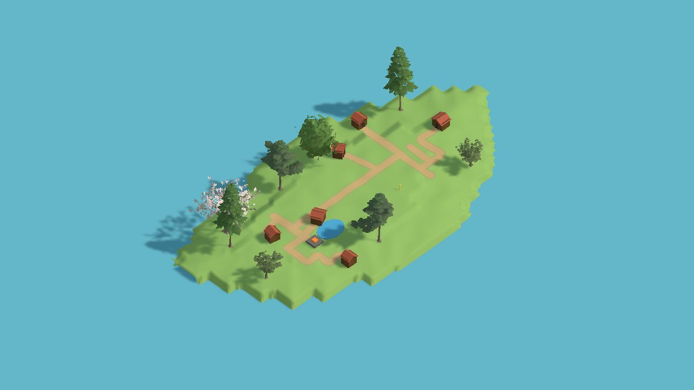
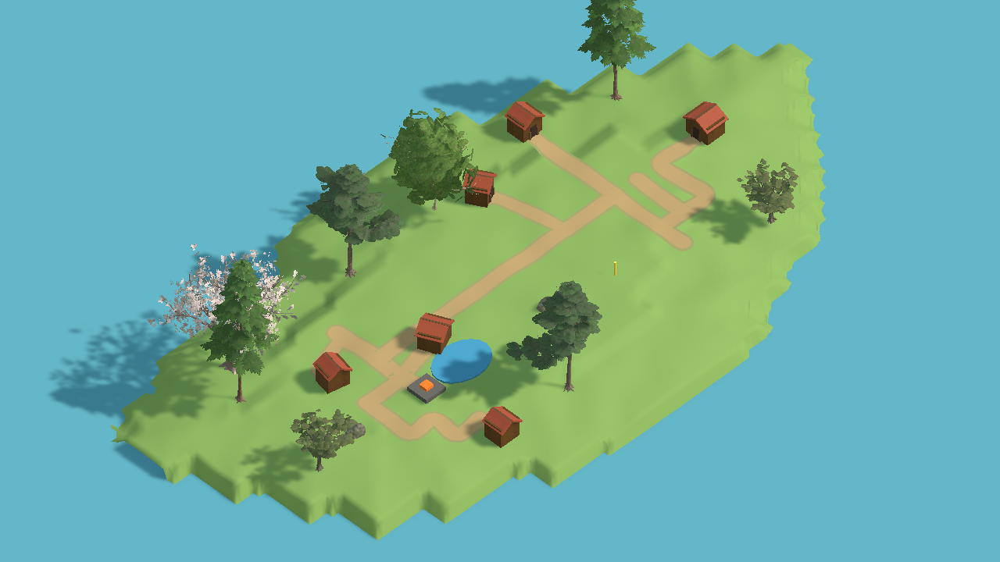
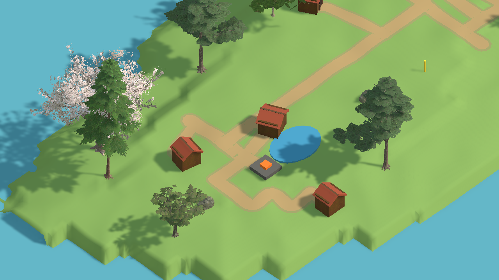
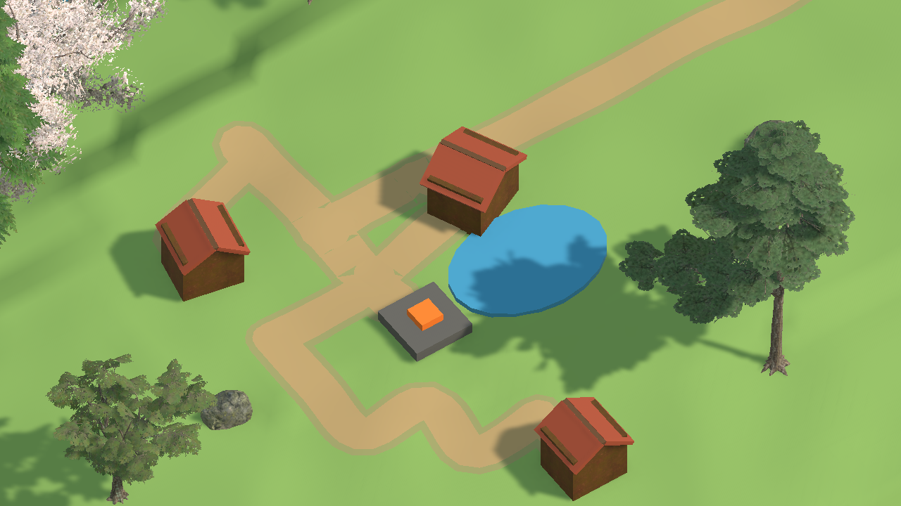
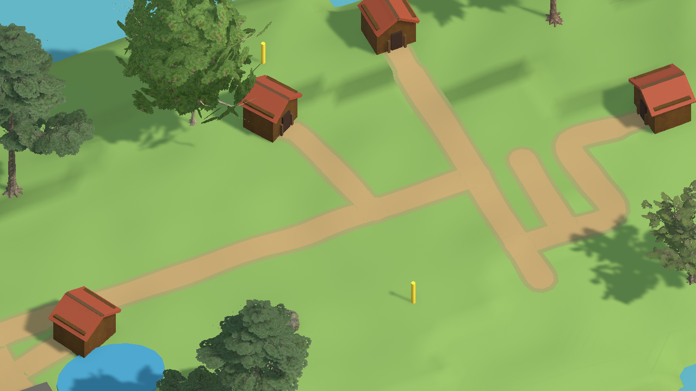
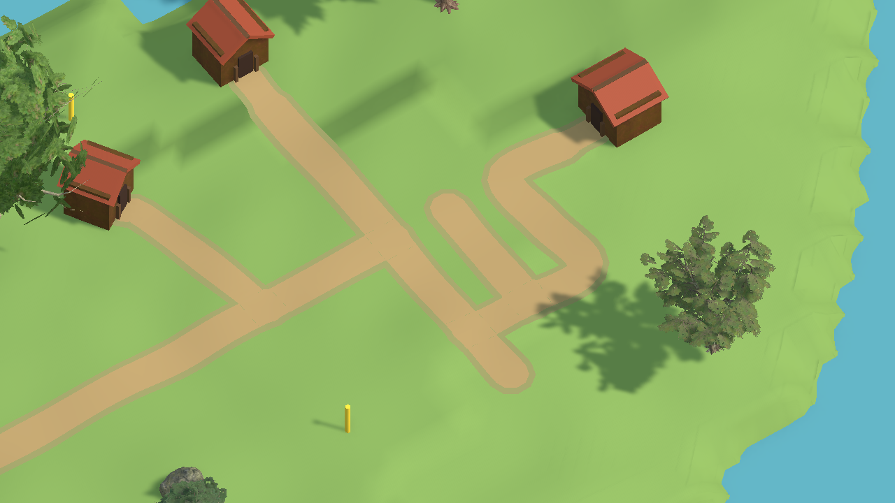
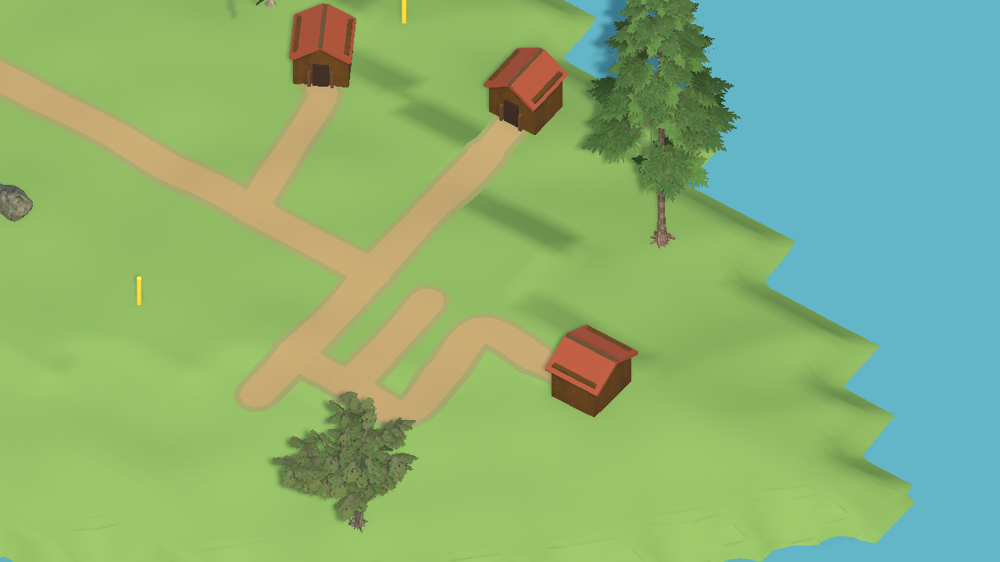
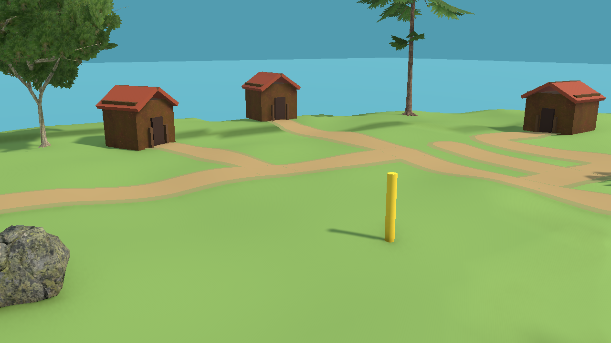

# Stage C-3C — Изолированная terrain-aware review-сцена сети тропинок

**Дата:** 2026-11-26  
**Ветка:** `feature/cozy-diorama-stage-c2-settlement-path-network`  
**Сцена:** `Assets/_Project/Scenes/Prototypes/CozyDioramaStageC3C.unity`  
**Статус:** PASS по всем автоматическим и визуальным гейтам Stage C-3C (production-код не изменялся)

---

## 1. Цель этапа

Проверить связку чистого планировщика топологии (`SettlementPathTopology`) и нового генератора непрерывной геометрии сети тропинок (`SettlementPathMeshBuilder`) на реальном рельефе (`ChunkTerrainMesher.Build` + `ChunkTerrainMesher.SampleVisualHeight`) через границу двух чанков `(0,0)` и `(1,0)` в полностью изолированной review-сцене до внесения любых правок в production.

---

## 2. Созданные файлы

- **`Assets/_Project/Scripts/World/SettlementPathMeshBuilder.cs`** — чистый, переиспользуемый генератор per-chunk мешей сети тропинок (`Core` + `Fringe`), без зависимостей от `MonoBehaviour`, `GameSaveData`, `ResidentPathGraph` и сценовых ссылок:
  - обрезает (trim) входящие ребра у каждого перекрёстка (`degree >= 3`) и строит явный герметичный веерный хаб (junction patch) по точным краевым вершинам лент — без дыр, нахлёстов и z-fighting;
  - разрезает полилинии точно по плоскостям границ чанков (`x = k*16 - 8`, `z = k*16 - 8`) с общими пограничными вершинами, общей высотой `sampleWorldY` и общими касательными;
  - прижимает ленты и хабы к реальному рельефу (`SampleVisualHeight`), считает нормали центральными разностями и принудительно контролирует ориентацию треугольников вверх (`cross.y >= 0`);
  - формирует `MeshBuildReport` с метриками клиренса, уклонов, обхода нормалей, стыка на границе чанков и детерминированным SHA-256 хэшем геометрии (`MeshHash`).
- **`Assets/_Project/Scripts/Editor/CozyDioramaStageC3CBuilder.cs`** — редакторский билдер review-сцены и рендер 8 контрольных ракурсов:
  - меню `AFK Island/Cozy Diorama/Stage C-3/Build Terrain-Aware Review Scene (C-3C)` и `AFK Island/Cozy Diorama/Stage C-3/Render C-3C Review Shots`.
- **`Assets/_Project/Scenes/Prototypes/CozyDioramaStageC3C.unity`**, меши в `Assets/_Project/Art/CozyDiorama/StageC3C/` и изолированные материалы `Assets/_Project/Art/CozyDiorama/Materials/Cozy_C3C_*.mat`.
- **Контрольные кадры и лог:** `Docs/CozyDiorama/StageC3C-Shots/` (`8` PNG + `terrain-report.txt`).

---

## 3. Результаты проверки (метрики из Unity Editor)

Источник: `Docs/CozyDiorama/StageC3C-Shots/terrain-report.txt`.

| Проверка | Результат |
|---|---|
| Сохранность `CozyDioramaStageB2.unity` | `7410EE060BA4E329` → `7410EE060BA4E329` (**unchanged=True**) |
| Сохранность `CozyDioramaStageC2.unity` | `061A92B92AF2F217` → `061A92B92AF2F217` (**unchanged=True**) |
| Детерминированность планировщика (`TopologyHash`) | `183F3BD2973ED15F` (**identical=True** на двойном прогоне) |
| Детерминированность мешей (`MeshHash`) | `A1DF2D67EB6BABED` (**identical=True** на двойном прогоне) |
| Граф сети | `nodes=24`, `edges=23`, `junctions=7`, `components=1`, `starterIssues=0` |
| Бюджет геометрии (2 чанка) | Core: `989` verts / `884` tris; Fringe: `992` verts / `887` tris; JunctionPatches: `7` |
| — Chunk `(0,0)` | Core `567v / 504t`, Fringe `570v / 507t`, `junctionPatches=3` |
| — Chunk `(1,0)` | Core `422v / 380t`, Fringe `422v / 380t`, `junctionPatches=4` |
| Клиренс Core над рельефом (`vertexY - SampleVisualHeight`) | `min=0.0360 m`, `max=0.0431 m` (без провалов и без зависания) |
| Максимальный уклон по тропе | `11.90°` (нарушений `> 28°`: `0`) |
| Контроль нормалей вверх | `minUpwardNormalDot=0.9616`, `downwardTriangles=0` |
| Стык через границу чанков `x = 8.0 m` | `sharedPairs=2` (магистраль + ветвь `Hut_Grown_BorderN`), `maxPosDelta=0.00000 m`, `maxHeightDelta=0.00000 m` |
| Подключение хижин | **6 / 6 подключены**, `0` блокировок, `0` нарушений |

### Подключение хижин (все 6/6)

| Хижина | Статус | Симуляционный yaw | Визуальный yaw | Длина ветви | Выравнивание у двери (`dot`) | Мин. зазор | Примыкание |
|---|---|---:|---:|---:|---:|---:|---|
| `Starter_Hut_A` | `Connected` | `12.0°` | `12.0°` | `1.87 m` | `0.99` | `0.28 m` | `Starter_Main_b_b` (`bezier-tight`) |
| `Starter_Hut_B` | `Connected` | `-25.0°` | `-25.0°` | `0.32 m` | `1.00` | `0.15 m` | `MaskRoad_8_8_to_18_8_a` (`bezier-tight`) |
| `Hut_Grown_BorderN` | `Connected` | `150.0°` | `150.0°` | `2.73 m` | `1.00` | `0.20 m` | `MaskRoad_8_8_to_18_8` (`bezier-tight`) |
| `Hut_Grown_North` | `Connected` | `180.0°` | `180.0°` | `0.57 m` | `1.00` | `0.37 m` | `MaskRoad_18_8_to_18_11` (`bezier-soft`) |
| `Hut_Grown_PondSW` | `Connected` | `0.0°` | `0.0°` | `0.57 m` | `1.00` | `0.37 m` | `MaskRoad_8_4_to_6_7` (`bezier-soft`) |
| `Hut_Grown_East_Reversed` | `ConnectedWithVisualDoorCorrection` | `90.0°` | `-90.0°` | `0.54 m` | `1.00` | `0.38 m` | `MaskRoad_19_6_to_21_8` (`bezier-soft`) |

> Примечание: `Starter_Hut_A` (`(-1.6, 0.9)`, `yaw 12°`), `Starter_Hut_B` (`(1.8, -0.2)`, `yaw -25°`), пруд (`(1.8, -1.4)`, `rx=1.1, rz=0.8`) и очаг (`(0.15, -1.5)`) размещены в точных production-позах `IslandPrototypeBuilder` / `WaterSourceLayout`. У `Hut_Grown_East_Reversed` симуляционная позиция и yaw не запрещаются — применена только визуальная коррекция поворота двери в сторону сети.

---

## 4. Контрольные скриншоты

### Общие планы (2 чанка: `(0,0)` + `(1,0)`)

### Стартовая зона, пруд и очаг

- `Starter_Cross` плавно огибает северный край пруда (`starterIssues=0`), ни ядро, ни окантовка не заходят в воду.
- Юго-западная ветвь обходит очаг с западной стороны и без коллизий стыкуется с дверью `Hut_Grown_PondSW`.

### Граница чанков `x = 8.0 m` (отмечена двумя жёлтыми колышками на траве)

- Оба пересечения границы чанков (основная магистраль и ветвь к `Hut_Grown_BorderN`) проходят без шва, без ступеньки по высоте и без разрыва (`maxPosDelta=0.00000 m`, `maxHeightDelta=0.00000 m`).

### Перекрёсток 4-way, T-стык, блок 2×2 и визуальная коррекция двери

- На 4-way перекрёстке `(18, 8)` и T-стыке `(18, 7)` нет дыр, нахлёстов и двойного затемнения (в отличие от 11G `PlacePathRibbon`).
- Все 3 выросшие хижины восточного/северного сектора имеют плотное примыкание дорожки к порогу; у `Hut_Grown_East_Reversed` дверь визуально развёрнута к сети (`90° -> -90°`).

### Низкий перспективный ракурс — проверка прилегания к рельефу

- Сплошной меш тропинок плавно огибает неровности рельефа без висящих краёв, проваливания в траву и z-fighting; хижины стоят вплотную на склонах/плато.

---

## 5. Важные технические находки этапа C-3C (учесть в C-3D)

1. **Кэширование Mesh-буферов в Unity 6 / GPU Resident Drawer:** при перезаписи существующего `.asset` через `EditorUtility.CopySerialized` GPU-буфер мог сохранять старую геометрию до пересоздания ассета. В runtime-рендерере C-3D при пересборке чанка следует создавать свежий `Mesh` (с корректным `Destroy` предыдущего) либо явно обновлять `MeshFilter.sharedMesh` и буферы после `Clear()`.
2. **Определение суши для ветвей (`IsInsideLand`):** в реальной генерации суша должна включать `CellStage >= Soil` (с буфером берега `>= Roots`), иначе хижины на границе `Soil/Moss` ложно отсеиваются как `out_of_land`.
3. **Запас вокруг очага и пруда:** стартовые пути `Starter_Main` / `Starter_Cross` должны завершаться у кромки очага и проходить севернее края пруда, чтобы окантовка (`Fringe`) не заходила в воду и не проходила под постаментом очага.

---

## 6. Что НЕ изменялось и что НЕ запускалось

- **Не изменялись:** production-скрипты (`HomeSettlementVisualizer.cs`, `IslandPrototypeBuilder.cs`, `ChunkTerrainMesher.cs`, `GrowthWorldPlacement.cs`, `IslandMeshVisualizer.cs`, `ResidentPathGraph`, `ResidentRoster`, Save v8 / миграции, офлайн-симуляция, рост мира, рыбалка, коллекции, правила спавна хижин), 9 локальных незакоммиченных файлов 11G, а также review-сцены Stage B-2 и Stage C-2.
- **Не запускались:** Play Mode, `MainIsland.unity`, smoke-тесты runtime и Android APK build (не входят в изолированный этап C-3C; планируются на этапе интеграции C-3D).

---

## 7. Готовность к Stage C-3D

Изолированная проверка на реальном рельефе и границе двух чанков полностью пройдена. Чистый пайплайн `SettlementPathTopology` → `SettlementPathMeshBuilder` готов к проектированию и согласованию точечной интеграции в `HomeSettlementVisualizer` (Stage C-3D).
