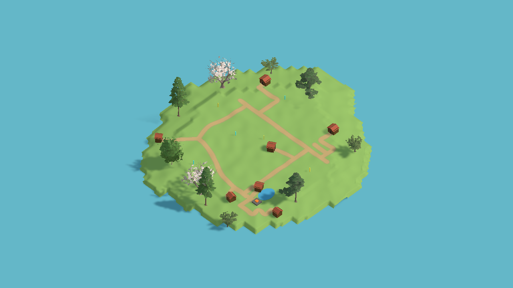
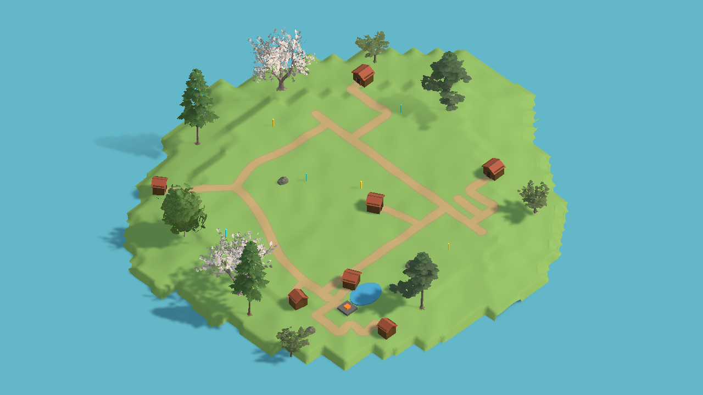
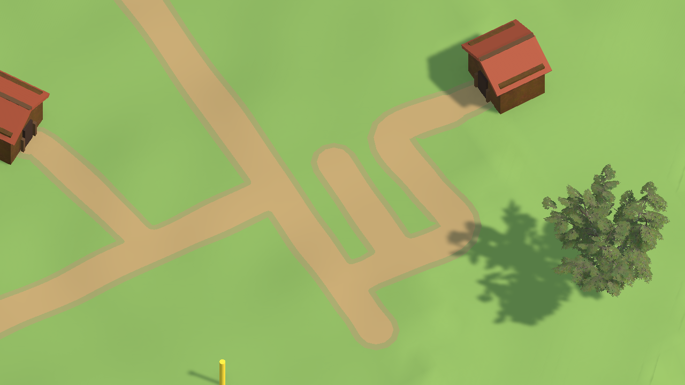
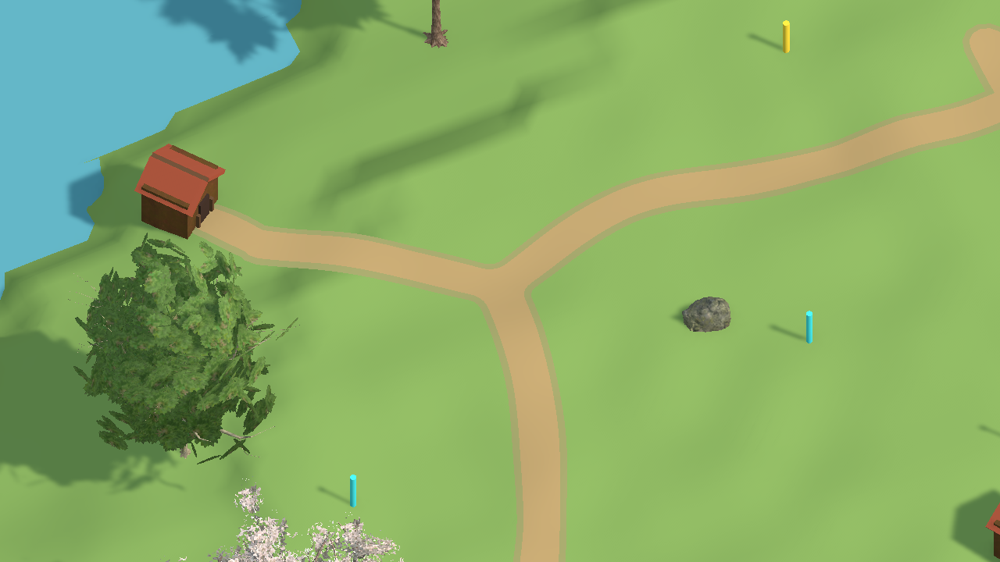
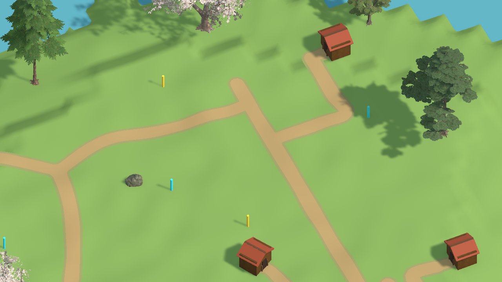
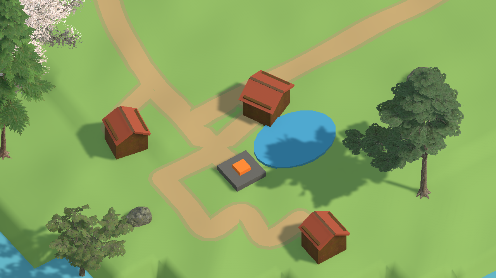
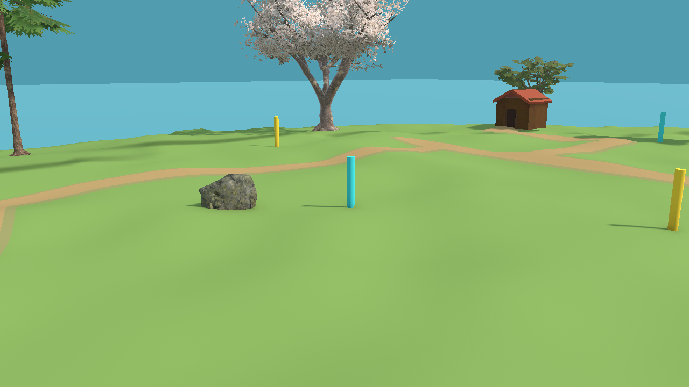
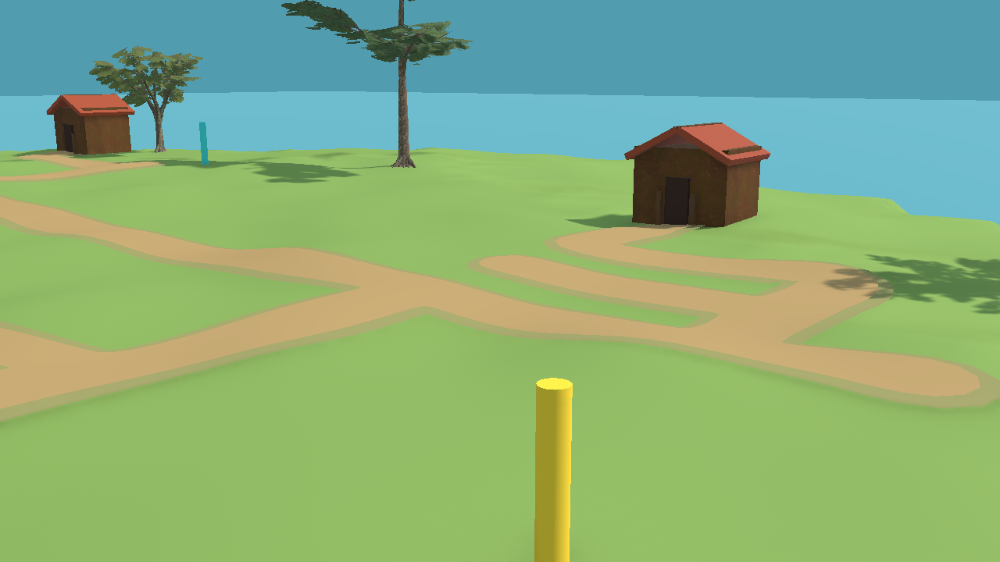

# Stage C-3D — Standalone `Path Network Renderer` (изолированная review-сцена 2×2 чанка)

**Дата:** 2026-11-26  
**Ветка:** `feature/cozy-diorama-stage-c2-settlement-path-network`  
**Сцена:** `Assets/_Project/Scenes/Prototypes/CozyDioramaStageC3D.unity`  
**Статус:** PASS по всем автоматическим, геометрическим, lifecycle/leak и визуальным гейтам Stage C-3D (production-код не изменялся)

---

## 1. Цель этапа

Собрать и всесторонне проверить самостоятельный рендерер сети тропинок (`SettlementPathNetworkRenderer`) и обновлённый генератор геометрии (`SettlementPathMeshBuilder`) в полностью изолированной 4-чанковой (`2×2`) review-сцене **без** подключения в `HomeSettlementVisualizer` и без любых правок production-систем:

- непрерывные 3-колоночные ленты (`Left / Center / Right`), плотно прилегающие к реальному рельефу (`ChunkTerrainMesher.SampleVisualHeight`);
- отдельная скруглённая геометрия перекрёстков, T-узлов и Y-развилок с вогнутыми Bezier-филлетами и по-вершинным стыком с лентами;
- защита от самопересечений (foldback) на крутых изгибах и контроль ширины/нормалей;
- бесшовные границы чанков по обеим осям (**X** и **Z**);
- инкрементальное обновление только изменённых (dirty) чанков без пересборки соседних;
- нулевые утечки `Mesh` и `Material` (`sharedMaterial`-only, явное владение и очистка runtime-мешей).

---

## 2. Изменённые и созданные файлы

- **`Assets/_Project/Scripts/World/SettlementPathMeshBuilder.cs`** *(обновлён, 100% обратно совместим с Stage C-3C)*:
  - 3-колоночное сечение ленты (`Left`, `Center`, `Right` — 4 треугольника на шаг) с индивидуальным сэмплингом высоты рельефа в каждой колонке (`SampleVisualHeight`), исключающее провисание на гребнях и провалы в ложбинах;
  - вогнутые C1-скруглённые Bezier-филлеты в `EmitJunctionPatch` + `ComputeFilletControlPoint` для 4-сторонних перекрёстков, T-узлов (прямая «спинка» на 180° + скруглённые внутренние углы на 90°) и Y-развилок; точное совпадение всех 3 граничных вершин (`Right`, `Center`, `Left`) с входящими лентами;
  - C1-затухание органической вариации ширины к концам ребра (`sin(u*π)^2`) и детерминированный кросс-платформенный хэш FNV-1a (`StableStringHash`), гарантирующий совпадение ширины на стыках и границах чанков;
  - 4-проходная монотонная релаксация внутреннего края на крутых изгибах для полного устранения foldback-треугольников;
  - вычисление per-chunk сигнатур входных данных (`ComputeChunkInputSignatures`) и селективная пересборка `onlyChunks` в `BuildPerChunk`;
  - расширенная диагностика `MeshBuildReport`: `MinRibbonWidthMeters`, `MaxRibbonWidthMeters`, `FoldbackTriangles`, `FoldbacksPrevented`, `JunctionAttachPairs`, `MaxJunctionAttachDelta`, `BorderSharedPointPairs`, `MaxBorderPositionDelta`, `MaxBorderHeightDelta`, а также per-chunk `ChunkHash`.
- **`Assets/_Project/Scripts/World/SettlementPathNetworkRenderer.cs`** *(новый standalone `MonoBehaviour`, без зависимостей от production/Save/`ResidentPathGraph`)*:
  - публичный контракт: `ConfigureMaterials(core, fringe)`, `ApplyPlan(plan, sampleWorldY, config, forceFullRebuild, terrainVersion)`, `TryGetChunkMeshes(chunk, out core, out fringe)`, `GetStats()`, `Clear()`;
  - кэш сигнатур чанков для инкрементального обновления только dirty-чанков (нетронутые чанки переиспользуются без аллокаций);
  - строгое использование `sharedMaterial` (0 дубликатов материалов);
  - явный учёт и уничтожение всех созданных runtime-мешей при пересборке чанка, удалении чанка, `Clear()` и `OnDestroy()`.
- **`Assets/_Project/Scripts/Editor/CozyDioramaStageC3DBuilder.cs`** *(новый редакторский билдер 2×2 review-сцены и 5-проходного lifecycle/leak теста)*:
  - меню `AFK Island/Cozy Diorama/Stage C-3/Build Path Network Renderer Review Scene (C-3D)` и `AFK Island/Cozy Diorama/Stage C-3/Render C-3D Review Shots`.
- **`Assets/_Project/Scenes/Prototypes/CozyDioramaStageC3D.unity`**, меши в `Assets/_Project/Art/CozyDiorama/StageC3D/` и изолированные материалы `Assets/_Project/Art/CozyDiorama/Materials/Cozy_C3D_*.mat`.
- **Контрольные кадры и отчёт:** `Docs/CozyDiorama/StageC3D-Shots/` (`8` PNG + `renderer-report.txt`).

---

## 3. Результаты автоматической проверки (Unity Editor `6000.6.5f1`)

Источник: `Docs/CozyDiorama/StageC3D-Shots/renderer-report.txt`.

### 3.1 Сохранность предыдущих этапов и детерминизм

| Проверка | Результат |
|---|---|
| Сохранность `CozyDioramaStageB2.unity` | `7410EE060BA4E329` → `7410EE060BA4E329` (**unchanged=True**) |
| Сохранность `CozyDioramaStageC2.unity` | `061A92B92AF2F217` → `061A92B92AF2F217` (**unchanged=True**) |
| Сохранность `CozyDioramaStageC3C.unity` | `A076681D7C0FC9CB` → `A076681D7C0FC9CB` (**unchanged=True**) |
| Детерминированность планировщика (`planHash`) | `3A2B5767CD1AD376` (**identical=True**) |
| Детерминированность мешей (`meshHash`) | `3629F2799DD7AEFB` |

### 3.2 Lifecycle, инкрементальные обновления и контроль утечек `SettlementPathNetworkRenderer`

| Проход | Сценарий | Результат |
|---|---|---|
| Pass 1 | Полная первичная сборка (4 чанка) | **PASS** (`rebuilt=4`) |
| Pass 2 | Повторный `ApplyPlan` без изменений (идемпотентность) | **PASS** (`reused=4`, 0 пересборок) |
| Pass 3 | Мутация только чанка `(1,1)` (добавлена хижина `Hut_Incremental_NE`) | **PASS** (`rebuilt=1`, `reused=3`) |
| Pass 4 | Сравнение хэша инкрементального результата с принудительной полной пересборкой | **PASS** (`inc=7F7341FCA2AE44BE == full=7F7341FCA2AE44BE`) |
| Pass 5 | `Clear()` — проверка полного освобождения runtime-мешей | **PASS** (`created == destroyed`, `liveOwned == 0`) |
| Финальное состояние | 4 активных чанка (`Core` + `Fringe`), материалы | `activeMeshes=8`, `liveOwnedMeshes=8`, `totalCreated=26`, `totalDestroyed=18`, `sharedMaterialsOnly=True` |

### 3.3 Геометрия, рельеф, стыки и границы чанков (4 чанка: `(0,0)`, `(1,0)`, `(0,1)`, `(1,1)`)

| Метрика | Значение |
|---|---|
| Топология сети | `nodes=30`, `edges=30`, `junctions=10`, `components=1`, `starterIssues=0` |
| Бюджет геометрии (4 чанка) | Core: `2325` verts / `2743` tris; Fringe: `2297` verts / `2715` tris; JunctionPatches: `10` |
| — Chunk `(0,0)` | Core `912v / 1055t`, Fringe `912v / 1055t`, `junctionPatches=4` (`hash=55599C38EADA8B64`) |
| — Chunk `(1,0)` | Core `641v / 762t`, Fringe `621v / 742t`, `junctionPatches=4` (`hash=5460B31D52C7E676`) |
| — Chunk `(0,1)` | Core `346v / 423t`, Fringe `346v / 423t`, `junctionPatches=1` (`hash=4A87B05B9BCB1397`) |
| — Chunk `(1,1)` | Core `426v / 503t`, Fringe `418v / 495t`, `junctionPatches=1` (`hash=7DF38682399F527F`) |
| Клиренс Core над рельефом (`vertexY - SampleVisualHeight`) | **`min=0.0360 m`, `max=0.0360 m`** (точное 3-колоночное прилегание по всей сети) |
| Контроль ширины ленты Core | `min=0.4177 m`, `max=0.6191 m` |
| Максимальный уклон по тропе | `13.07°` (нарушений `> 28°`: `0`) |
| Контроль нормалей вверх | `minUpwardNormalDot=0.2663`, **`downwardTriangles=0`** |
| Защита от самопересечений (foldback) | **`remainingFoldbacks=0`**, `foldbacksPrevented=12` |
| Точность стыковки лент с хабами перекрёстков | `verifiedPairs=93`, **`maxDelta=0.00000 m`** |
| Непрерывность границ чанков по осям **X** и **Z** | `sharedPairs=4`, **`maxPosDelta=0.00000 m`**, **`maxHeightDelta=0.00000 m`** |
| Подключение хижин | **7 / 7 подключены**, `0` нарушений |

### 3.4 Подключение хижин (7 / 7)

| Хижина | Статус | Симуляционный yaw | Визуальный yaw | Длина ветви | Выравнивание у двери (`dot`) | Мин. зазор | Примыкание |
|---|---|---:|---:|---:|---:|---:|---|
| `Starter_Hut_A` | `Connected` | `12.0°` | `12.0°` | `1.87 m` | `0.99` | `0.28 m` | `Starter_Main_b_b` (`bezier-tight`) |
| `Starter_Hut_B` | `Connected` | `-25.0°` | `-25.0°` | `0.32 m` | `1.00` | `0.15 m` | `MaskRoad_8_8_to_18_8_a` (`bezier-tight`) |
| `Hut_PondSW` | `Connected` | `0.0°` | `0.0°` | `0.57 m` | `1.00` | `0.37 m` | `MaskRoad_8_4_to_6_7` (`bezier-soft`) |
| `Hut_BorderX_N` | `Connected` | `150.0°` | `150.0°` | `2.73 m` | `1.00` | `0.20 m` | `MaskRoad_8_8_to_18_8` (`bezier-tight`) |
| `Hut_East_Reversed` | `ConnectedWithVisualDoorCorrection` | `90.0°` | `-90.0°` | `0.54 m` | `1.00` | `0.38 m` | `MaskRoad_19_6_to_21_8` (`bezier-soft`) |
| `Hut_HillNW` | `Connected` | `145.0°` | `145.0°` | `0.83 m` | `1.00` | `0.27 m` | `Hillside_YFork_NW` (`bezier-tight`) |
| `Hut_Incremental_NE` | `Connected` | `-90.0°` | `-90.0°` | `0.54 m` | `1.00` | `0.38 m` | `MaskRoad_18_16_to_21_19` (`bezier-soft`) |

---

## 4. Контрольные скриншоты

### Общие планы (4 чанка: `(0,0)`, `(1,0)`, `(0,1)`, `(1,1)`)

### 4-сторонний перекрёсток, T-узлы, скругления и S-кривая (стресс-тест foldback)

### Y-развилка и плавные изгибы по склону в чанке `(0,1)`

### Границы чанков по осям X (жёлтые колышки) и Z (голубые колышки) + инкрементальный чанк `(1,1)`

### Стартовая деревня, очаг и пруд

### Низкие ракурсы — прилегание 3-колоночных лент и хабов к рельефу

---

## 5. Затронутые системы, риски и честный статус проверок

- **Что НЕ трогалось:**
  - `HomeSettlementVisualizer.cs` и все 9 локальных незакоммиченных файлов ветки 11G;
  - `Save` v8 / миграции, offline-симуляция, скорость роста, `WorldGrowthConfig`, расширение острова, растения/животные/погода/рыбалка;
  - `ResidentPathGraph`, `ResidentRoster`, правила симуляции размещения и ориентации хижин;
  - review-сцены `CozyDioramaStageB2.unity`, `CozyDioramaStageC2.unity`, `CozyDioramaStageC3C.unity`.
- **Что проверено в Unity Editor `6000.6.5f1`:**
  - чистая компиляция C# без ошибок;
  - полный прогон `Build Path Network Renderer Review Scene (C-3D)` + рендер всех 8 ракурсов;
  - 5-проходный тест `SettlementPathNetworkRenderer` (полная сборка, идемпотентность, инкрементальная пересборка 1 из 4 чанков, совпадение хэшей, `Clear()` с 0 утечек `Mesh` и `sharedMaterial`-only).
- **Что НЕ запускалось на этом этапе (запланировано на C-3F / C-3H):**
  - Play Mode в production-сцене `MainIsland.unity`;
  - Android APK build и проверка на устройстве;
  - интеграция в `HomeSettlementVisualizer` (следующий этап — **C-3E** за feature flag).
- **Наблюдения и остаточные риски для C-3E/C-3G:**
  - `minUpwardNormalDot = 0.2663` возникает на узких острых треугольниках внутреннего филлета у самого плотного 1-клеточного поворота (при этом `downwardTriangles = 0`, `remainingFoldbacks = 0`, визуально дефектов нет); при полировке в C-3G можно дополнительно сгладить распределение шагов вдоль филлета;
  - в C-3E при подключении к `HomeSettlementVisualizer` потребуется аккуратно синхронизировать `terrainVersion` (при перестройке чанка или появлении новой воды/расширении острова) и аккуратно обойти 11G-код за feature flag без поломки legacy-пути.
