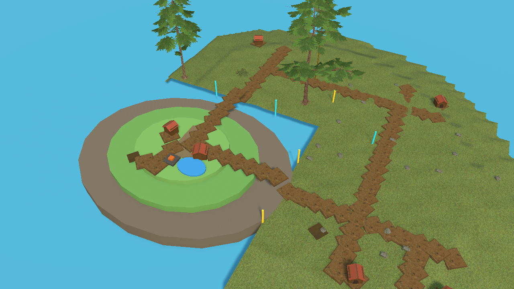
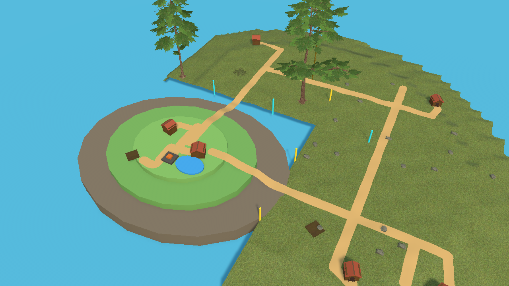
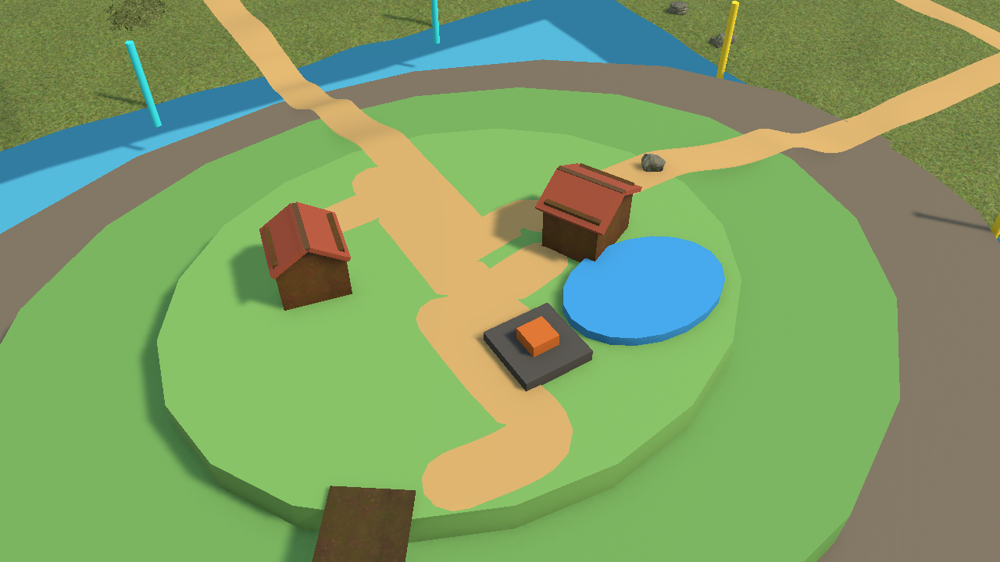
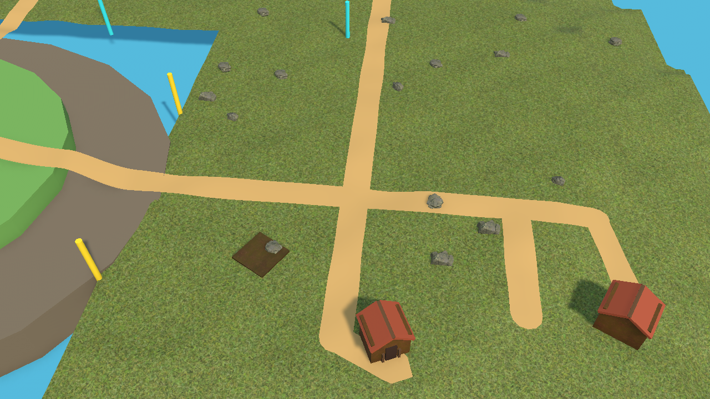
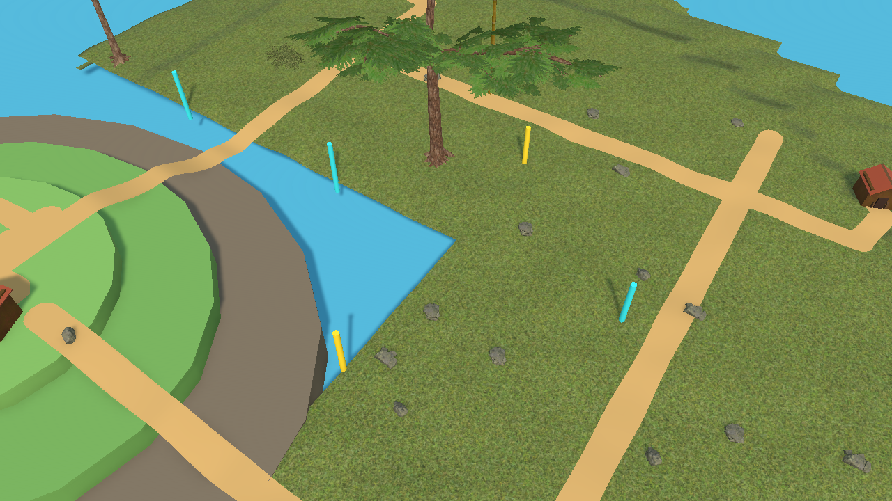
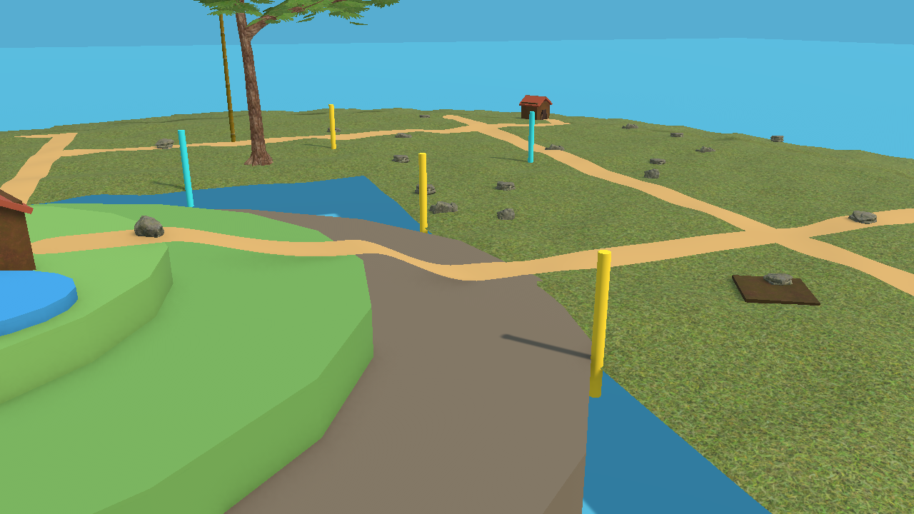

# Stage C-3E — Проверка компиляции и интеграции в Unity 6 (`6000.6.5f1`)

**Дата:** 2026-11-26  
**Ветка:** `feature/cozy-diorama-stage-c3e-integration`  
**Изолированная тестовая сцена:** `Assets/_Project/Scenes/Prototypes/CozyDioramaStageC3E.unity`  
**Статус:** **PASS** в Unity 6 (`6000.6.5f1`) по компиляции C# и всем 6 проходам интеграционной проверки (flag OFF, OFF→ON, no-op, `WaterSource` invalidation, ON→OFF rollback + 0 утечек `Mesh`, повторное включение). Флаг по умолчанию остаётся **`useContinuousPathNetworkRenderer = false`**. `MainIsland.unity` и 9 локальных файлов 11G не затрагивались.

---

## 1. Результаты первичной проверки исходного коммита `a36c649` в Unity 6

Проверка выполнялась в изолированном git worktree на ветке `feature/cozy-diorama-stage-c3e-integration` без изменения основного рабочего дерева (`11G`).

### 1.1 Ошибка компиляции C# (подтверждена реальным прогоном Unity 6)

- **`Assets/_Project/Scripts/World/HomeSettlementVisualizer.cs(850,17): error CS1503`**  
  `Argument 2: cannot convert from 'method group' to 'System.Func<float, float, float>'`  
  Причина: `SettlementPathNetworkRenderer.ApplyPlan` ожидает делегат `Func<float, float, float>`, а `WorldTerrainSampleCache.SampleHeight(float worldX, float worldZ, float chunkSize)` принимал 3 аргумента.

### 1.2 Runtime- и визуальные дефекты, выявленные при аудите и тестовом прогоне

1. **Двойные дорожки при переключении флага (`false ↔ true`):** ни `BuildSignature(data)`, ни per-chunk `chunkSig` не включали `useContinuousPathNetworkRenderer`, из-за чего старые `Path_Tile` не удалялись при включении флага и не восстанавливались при выключении.
2. **Дублирование стартовых дорожек `World/Island/Settlement/Path_*`:** при `useContinuousPathNetworkRenderer = true` поверх новых непрерывных стартовых лент оставались активны authored-объекты `Path_Main` и `Path_Cross`.
3. **Высота legacy home island (`isLegacyBase == true`):** на стартовом острове (`Chunk (0,0)`) `SettlementYard` находится на `Y ≈ 1.85 m`, тогда как `ChunkTerrainMesher.SampleVisualHeight` возвращал высоту выросшего чанка (`~0.65 m`), из-за чего стартовые ленты проваливались внутрь стартового острова на `1.2 m`.
4. **Заступ `Starter_Cross` на край пруда:** `CreateProductionStarterPaths` заканчивал `Starter_Cross` на `z = -0.60`, что совпадало с северным краем `WaterSource` (`z = -1.40 + 0.80 = -0.60`), давая `starterIssues = 1` и `12` вершин внутри эллипса пруда.
5. **Поиск `GameObject.Find("WaterSource")` на каждом кадре в `LateUpdate()`** при включённом флаге.
6. **Паритет фильтрации масок и визуальный поворот двери:** `RebuildContinuousPathNetwork` не фильтровал `WaterSourceLayout.BlocksSettlementCell` и `landStage < CellStage.Moss` (как `PlaceChunkProps`) и не применял визуальную коррекцию yaw (`ConnectedWithVisualDoorCorrection`) к заспавненному префабу `Hut_{cellIndex}`.
7. **`Destroy(...)` вместо `SafeDestroy`:** при очистке в Edit Mode вызывался `Destroy` вместо `DestroyImmediate`.

---

## 2. Внесённые исправления на ветке `feature/cozy-diorama-stage-c3e-integration`

- **`Assets/_Project/Scripts/World/WorldTerrainSampleCache.cs`:**
  - добавлены перегрузки `SampleHeight(wx, wz)` и `IsInsideLand(wx, wz, chunkSize)`;
  - добавлена C1-гладкая высотная огибающая стартового legacy-острова (`SampleLegacyHomeEnvelopeY`, активируется только при наличии `isLegacyBase` в `(0,0)`): стартовые дорожки лежат на `SettlementYard` (`1.85 m`) и плавно сходят через `MidPlateau` (`1.41 m`) и `BaseRock` (`0.81 m`) к точной высоте `ChunkTerrainMesher.SampleVisualHeight` на границе чанка (`maxHeightDelta = 0.00000 m`).
- **`Assets/_Project/Scripts/World/SettlementPathTopology.cs`:**
  - добавлен `CreatePondSafeProductionStarterPaths(TopologyConfig)` (исходный `CreateProductionStarterPaths` не изменён ради совместимости с Stage C-3B).
- **`Assets/_Project/Scripts/World/HomeSettlementVisualizer.cs`:**
  - исправлен `CS1503` (передача 2-аргументного делегата с `chunkSize`);
  - флаг `useContinuousPathNetworkRenderer` включён в `BuildSignature` и `chunkSig`;
  - добавлено обратимое скрытие/восстановление только authored `Path_*` (без касания `Hut_A`, `Hut_B`, `Hearth`, `Stone_*`);
  - кэширование `_cachedWaterSource` вместо `GameObject.Find` каждый кадр;
  - синхронизирована фильтрация воды/земли (`BlocksSettlementCell`, `landStage >= Moss`) и визуальная коррекция поворота двери у `Hut_{cellIndex}` без изменения сохранений и симуляции;
  - `SafeDestroy` для безопасной очистки в Play Mode и Edit Mode + `LastClearedRendererStats` для проверки нулевых утечек;
  - при `useContinuousPathNetworkRenderer = false` пропуск `_terrainSamples.Rebuild(data)` (нулевой overhead в legacy-режиме).
- **`Assets/_Project/Scripts/Editor/CozyDioramaStageC3EVerifier.cs`:**
  - изолированный 6-проходный верификатор и сборщик тестовой сцены `CozyDioramaStageC3E.unity` + рендер 6 контрольных скриншотов.

---

## 3. Результаты проверки в Unity 6 (`6000.6.5f1`)

Источник: `Docs/CozyDiorama/StageC3E-Shots/integration-report.txt`.

| Проверка | Результат |
|---|---|
| Компиляция C# в Unity `6000.6.5f1` | **0 ошибок** (`UnityExitCode=0`) |
| Значение флага по умолчанию (`useContinuousPathNetworkRenderer == false`) | **PASS** (`True`) |
| **Pass 1** — Flag OFF (Legacy) | **PASS** (`legacyPathTiles=84`, `authoredStarterPathsActive=2/2`, `clearings=2`, `stones=3`, `grownHuts=4`, `continuousRendererPresent=False`) |
| **Pass 2** — Toggle OFF → ON (Continuous) | **PASS** (`legacyPathTiles=0`, `authoredStarterPathsActive=0/2`, `authoredHutsAndHearthActive=3/3`, `clearings=2`, `stones=3`, `grownHuts=4`) |
| — Стартовые хижины и дедупликация | `Starter_Hut_A=Connected`, `Starter_Hut_B=Connected`, дубликат у `Starter_Hut_A` отфильтрован (**True**), всего **6 / 6 хижин подключены** |
| — Топология и перекрёстки | `nodes=26`, `edges=25`, `tJunctions=5`, `fourWayJunctions=3`, `starterIssues=0`, `planHash=B28E313BEDFAA612` |
| — Обход пруда | `waterViolations=0`, `coreVertsInsidePond=0` |
| — Геометрия, стыки и границы чанков (X & Z) | 4 чанка, Core `2646v / 3231t`, Fringe `2598v / 3183t`, клиренс `[0.0320, 0.0320] m`, `downwardTris=0`, `foldbacks=0` (`prevented=13`), `junctionPairs=81 maxDelta=0.00000 m`, `borderPairs=4 maxPosDelta=0.00000 m maxHeightDelta=0.00000 m` |
| — Материалы | `sharedMaterialsOnly=True` |
| **Pass 3** — Идемпотентный no-op rebuild | **PASS** (`applyCalls=1 == 1`) |
| **Pass 4** — Сдвиг и поворот `WaterSource` | **PASS** (`applyCalls=2`, `movedPondIntrusions=0`) |
| **Pass 5** — Toggle ON → OFF (откат + контроль утечек `Mesh`) | **PASS** (`rootDestroyed=True`, `zeroLeaks=True`: `created=16 == destroyed=16`, `liveOwned=0`; `legacyPathTilesRestored=84/84`, `authoredStarterPathsRestored=2/2`) |
| **Pass 6** — Повторное включение OFF → ON | **PASS** (`planHashMatch=True`, `meshHashMatch=True`, `legacyPathTiles=0`, `liveOwnedMeshes=8`) |
| Сохранность защищённых сцен (`MainIsland`, `B2`, `C2`, `C3C`, `C3D`) | **Все 5 `unchanged=True`** |

---

## 4. Контрольные скриншоты

### Сравнение Flag OFF (Legacy) vs Flag ON (Continuous)

### Стартовые хижины (`Hut_A`, `Hut_B`), очаг и обход пруда

### 4-сторонние и T-образные перекрёстки, камни, расчистки и выросшие хижины (`Hut_A` / `Hut_B`)

### Стыки границ чанков по осям X (жёлтые колышки) и Z (голубые колышки)

### Низкий ракурс — переход с legacy home island на выросший чанк `(1,0)`

---

## 5. Честный статус: что НЕ запускалось на этом этапе

- **Не запускалось:** Play Mode в `MainIsland.unity`, цикл save/load и offline growth на реальном Save v8, а также Android APK build и проверка на устройстве (это целевой объём **Stage C-3F** и **Stage C-3H**).
- **Не изменялось:** `MainIsland.unity`, `main`, Save v8/миграции, `SettlementSimulation`, `WorldGrowthConfig`, `ResidentPathGraph`, `ResidentRoster`, растения/животные/погода/рыбалка и 9 локальных файлов ветки `11G`.
