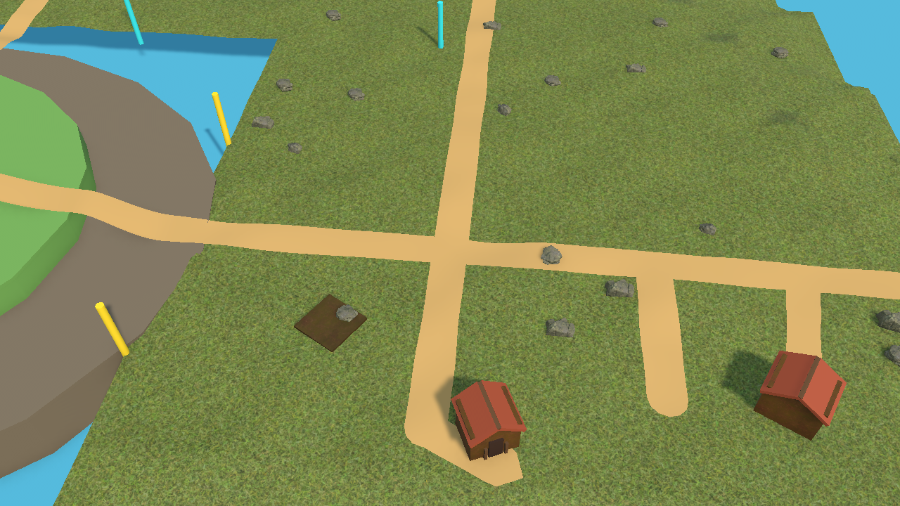
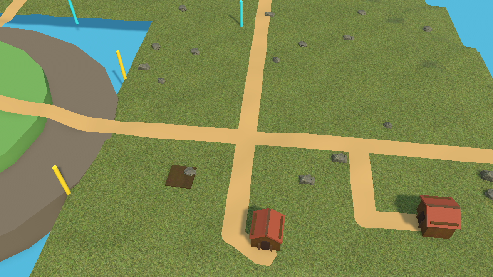
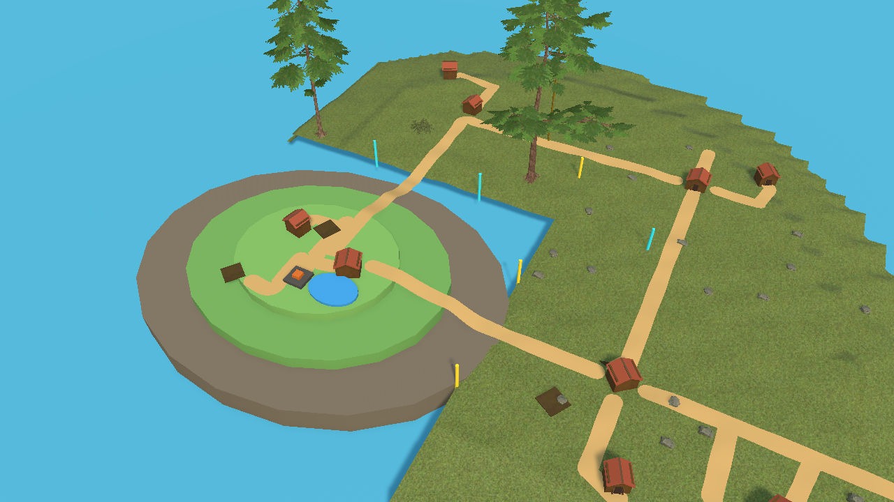
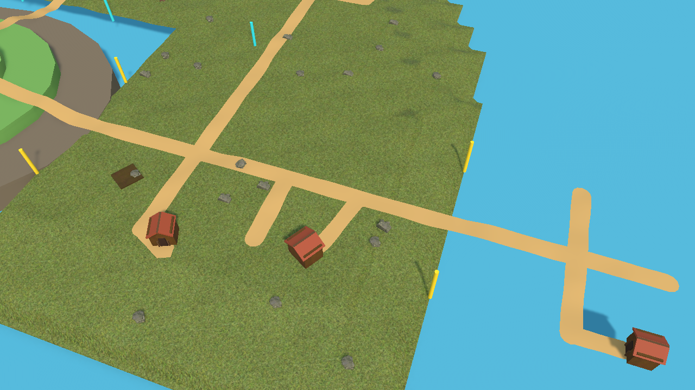

# Stage C-3F — Автоматическая проверка Save v8 immutability, seed-only invalidation и offline growth в Unity 6 (`6000.6.5f1`)

**Дата:** 2026-11-26  
**Ветка:** `feature/cozy-diorama-stage-c3f-mainisland-readiness`  
**Базовый коммит:** `ab63fe4`  
**Статус:** **PASS** по компиляции C# (включая `CozyDioramaStageC3FMainIslandDiagnostic.cs` и фикс `0336dd4`) и по всем 7 тестам изолированного прогона в Unity `6000.6.5f1`. Флаг по умолчанию остаётся **`useContinuousPathNetworkRenderer = false`**. `MainIsland.unity`, `main`, диски сохранений и 9 локальных файлов 11G не изменялись.

---

## 1. Добавленный инструмент проверки

- **`Assets/_Project/Scripts/Editor/CozyDioramaStageC3FSaveAndSeedVerifier.cs`**  
  Меню в Unity: `AFK Island → Cozy Diorama → Stage C-3F → Run Save v8 Immutability & Seed Invalidation Suite`  
  Batch-вход: `AfkIsland.Editor.CozyDioramaStageC3FSaveAndSeedVerifier.RunBatchVerification`
- Работает строго на временной пустой сцене и in-memory копиях `SaveClone.DeepClone(...)` без записи на диск и без изменения существующих сцен.

---

## 2. Результаты прогона в Unity 6 (`6000.6.5f1`)

Источник: `Docs/CozyDiorama/StageC3F-Shots/c3f-verification-report.txt`.

| Тест | Что проверялось | Результат |
|---|---|---|
| **Компиляция C#** | Компиляция всей ветки, включая `CozyDioramaStageC3FMainIslandDiagnostic.cs` и `0336dd4` | **0 ошибок** (`UnityExitCode=0`) |
| **Test 1** | Вызов `CozyDioramaStageC3FMainIslandDiagnostic.ReportRuntimeWiring()` вне Play Mode | **PASS** (безопасное предупреждение, без исключений и мутаций) |
| **Test 2** | Значение флага по умолчанию на новом `HomeSettlementVisualizer` | **PASS** (`useContinuousPathNetworkRenderer == false`) |
| **Test 3 — Save v8 Immutability** | Побайтовый SHA-256 `JsonUtility.ToJson(save)` до и после `IslandMeshVisualizer`, legacy `RebuildFromSave`, continuous `RebuildFromSave`, циклов `OFF ↔ ON` и сдвига `WaterSource` | **PASS** (`sha = BABD519D13AE4041` идентичен на всех 5 шагах; `version=8`, `lastSimulationUtc=1760000000`, `settlementWatermarkUtc=1760000000` не изменились) |
| **Test 4 — Seed-Only Invalidation (`0336dd4`)** | Изменение **только** `chunk(1,0).growthSeed` (`2002 → 9912345 → 2002`) без правки масок, воды и других чанков | **PASS** (`applyCalls: 3 → 4`; `Hut_70` yaw `155.6° → 183.3° → 155.6°`; `Hut_91` yaw `29.9° → 270.0° → 29.9°`; `planHash` и `meshHash` изменились и точно вернулись при откате seed; нетронутый чанк `(0,1)` сохранил прежний `ChunkHash`; Save v8 не изменился; `legacyPathTiles=0`, `foldbacks=0`, `downwardTris=0`) |
| **Test 5 — Isolated Offline Growth (+48h)** | Реальная in-memory симуляция `WorldGrowthSimulation.Simulate(+48h)` + `SettlementSimulation.Apply(+48h)` + `RebalanceExcessStones` на копии Save v8, затем визуальная пересборка | **PASS** (`simSuccess=True`, `appliedSeconds=172800`, `lastSimUtc: 1760000000 → 1760172800`, `settleWatermarkUtc=1760172800`, число хижин выросло `6 → 9`; SHA-256 Save v8 до/после визуальной пересборки `C293B4FA6731A3C5` совпадает побайтово; `legacyPaths=0`, `pondIntrusions=0`, `foldbacks=0`, `downwardTris=0`, `maxBorderPos=0.00000 m`, `liveOwnedMeshes=8`) |
| **Test 6 — Chunk Add / Remove / Reload & OFF Rollback** | Добавление чанка `(2,0)` через границу `x = 24.0 m`, удаление `(2,0)`, повторное добавление и откат флага в `false` | **PASS** (`chunks: 4 → 5 → 4`, `maxBorderPos=0.00000 m`, слот и `SettlementChunk_2_0` удалены без хвостов, повторная загрузка дала идентичный `MeshHash`; при откате `OFF`: `rootGone=True`, `zeroLeaks=True` (`created=84 == destroyed=84`, `liveOwned=0`), `authoredRestored=True`, `legacyTilesRestored=88/88`) |
| **Test 7 — Защищённые сцены** | SHA-256 `MainIsland.unity`, `B2`, `C2`, `C3C`, `C3D`, `C3E` до/после | **PASS** (все 6 сцен `unchanged=True`) |

---

## 3. Контрольные скриншоты

### Seed-only invalidation (`chunk(1,0).growthSeed: 2002 → 9912345`)

> На правом кадре хорошо видно, что после изменения только `growthSeed` (без изменения масок) правая хижина `Hut_91` повернулась с `29.9°` на `270.0°`, а её подводящая дорожка автоматически перестроилась к новому положению двери.

### После изолированного offline growth (`+48 ч`, выросло 3 новых хижины)

> Наблюдение для полировки в C-3G: существующая симуляция `SettlementSimulation` может повышать клетку `Path` прямо в узле перекрёстка до `Hut` (на кадре видно по одной новой хижине в `(1,0)` и `(1,1)`). Новый рендерер корректно выдерживает этот сценарий без сбоев, foldback и утечек; логику `SettlementSimulation` в рамках C-3F не меняли.

### Динамическое добавление чанка `(2,0)` через границу `x = 24.0 m`

---

## 4. Честный статус проверок (что пройдено и что ещё впереди)

- **Пройдено в реальном Unity 6 (`6000.6.5f1`):**
  - чистая компиляция всей ветки `feature/cozy-diorama-stage-c3f-mainisland-readiness` (включая `CozyDioramaStageC3FMainIslandDiagnostic.cs`);
  - автоматическая проверка побайтовой неизменности Save v8 до/после визуальной перестройки и переключений флага;
  - проверка seed-only invalidation (`0336dd4`) с детерминированным откатом;
  - изолированный in-memory прогон `WorldGrowthSimulation` + `SettlementSimulation` (+48h) с проверкой неизменности Save v8 и визуальной перестройки;
  - жизненный цикл добавления/удаления/перезагрузки чанка и отката флага с `0` утечек `Mesh`.
- **Ещё НЕ запускалось (остаётся для ручной/финальной приёмки):**
  - интерактивный Play Mode в реальной сцене `MainIsland.unity` с реальным `GameBootstrap` и меню `Report MainIsland Runtime Wiring`;
  - загрузка реального пользовательского Save v8 с диска;
  - Android APK build и проверка на устройстве (**Stage C-3H**).
